# Exhibit — Architecture

Companion to `product_requirement_doc.md` (the *what* and the boundaries) and
`technical_stack.md` (the *with what*). This document describes how the system is
structured: components, boundaries, data flow. It states each decision and the
invariant it protects; the reasoning behind a decision lives in the ticket named
beside it (`tk show <id>`). `security.md` carries the full security policy.

## 1. Architectural principles

1. **It's just a file.** A tier-1/2 artifact is a self-contained document that runs
   in the *visitor's* browser. The service stores and serves it; optional share
   previews run only its widget in a browser satellite (§3.2). The user can take
   their software and data with them.
2. **One write path.** Every mutation, state write-through included, enters through
   the HTTP API. Auth, validation, replication and multi-user attach there.
3. **Two origins, hard boundary.** The app and the artifacts it renders live on
   different origins. The trust boundary is enforced by the browser, not by code
   convention.
4. **Observe, don't predict.** No analysis ahead of time decides an artifact's
   behavior. Interceptors and policy sit at the runtime boundary. Scans may inform
   heuristics, never a contract.
5. **Security should be simple, and by default.** The secure choice is the default,
   and is secure by the shape of the design rather than the details of its code.

(A former principle, "easy path and serious path share one system", is deprecated.)

## 2. System context



One Go process answers both origins as two route groups. The operator's reverse
proxy maps hostnames to it and terminates TLS (`deployment.md`).

## 3. Components and responsibilities

### 3.1 API surface (the single write path)

The only way data changes. Full route reference: `api.md`.

- `POST /api/artifacts`: ingest a body, or a URL the service fetches once (stored as
  `source_url`). Runs the scan (§3.4), persists immediately and network-inert, and
  returns the footprint for approval (§5).
- `GET /api/artifacts[/:id]`: list and detail.
- `PATCH /api/artifacts/:id`: title, body, `network_allowlist` (the whole allow
  set; block rows are left alone), the capability approvals (`downloads_approved`,
  `clipboard_approved`, `links_approved`, `camera_approved`, `microphone_approved`,
  `geolocation_approved`, named once in `store.ApprovalColumns`, which drives a
  strict-boolean check in both handler and store),
  `share_state_mode` (checked against `store.ValidShareStateMode` in handler *and*
  store, av-6xjd), other scalars. A changed body is a new blob and a new version (§3.3b);
  an identical one writes nothing. The response carries the new footprint and
  `footprint_changed`, which re-runs the approval gate. If the previous body's
  bytes are missing the write still goes through (it is the repair) and
  `footprint_changed` is true; any other read failure aborts the whole PATCH
  (av-wu9d). Tags and collections use their own `POST/DELETE` membership routes.
- `POST /api/artifacts/:id/duplicate`: owner-only copy of current source, widget,
  assets and metadata, with optional owner state and share settings; copied shares
  get fresh identities. Staging and quota checks precede one atomic store
  transaction. A request UUID makes uncertain retries return the same copy, even
  after the original changes or disappears. The gallery refreshes its cards through
  htmx without navigating. Precise copy and retry rules:
  [artifact-duplication.md](artifact-duplication.md).
- `POST /api/artifacts/:id/refetch`: re-fetch `source_url` through the full ingest
  pipeline and record a new version (av-reo3, av-b17a). A non-2xx, empty or non-HTML
  response is refused with the artifact untouched; nothing else is judged. New blobs
  are staged, then `ReplaceArtifactSnapshot` switches body, search text and asset
  generation in one transaction. Body and assets are compared separately, since a
  runtime payload never appears in the body. A refetch that collected no assets
  keeps the existing ones. If fetch failures (including a failed stylesheet or
  script hiding its dependencies) leave any saved asset missing from the new
  collection, or a snapshot-level error occurs while saved assets exist, the
  refetch is a 400 before anything is written. Never writes the allowlist; returns
  `network_footprint`, `footprint_changed`, `undecided_origins` (footprint minus
  every origin already allowed *or blocked*), `updated`, `snapshot`.
- `GET …/versions`, `POST …/versions/:seq/restore`: history and restore (§3.3b).
  No route creates a version. Restore is owner-only and not in `agentSubResources`.
- `DELETE /api/artifacts/:id`: rows first, then bytes (every version's blobs), with
  the ids queued in the delete's transaction (§3.3a, av-7jcq). A failed blob delete
  is a 500, and the queue retries it.
- `GET/PUT/DELETE /api/artifacts/:id/state`: state rows (§6), scoped to the
  caller's own rows (av-q0ub). `PUT` is called by the host frame for the shim.
  `DELETE ?key=…` removes one key; `DELETE` with no `key` parameter erases every
  row the caller's principal resolves to, and nothing else. The key is a query parameter, never a path
  segment: a `..` key in a path normalizes to the artifact itself and would delete
  it (av-hh1o). A present-but-empty `key` is the empty-string key. Deletes are
  idempotent. The only route
  family a grantee may write (av-v991): handlers resolve one principal, the viewer,
  and the store's `…AsViewer` methods decide whose rows that means.
- `GET …/export`: the artifact as one self-contained file, assets folded back in as
  `data:` URIs (av-vnkt). The file is the canonical artifact; the URL form is
  internal and is materialized wherever the artifact leaves the service. One failed
  asset read fails the export. Lives in `internal/export` for the static build too.
- `GET …/assets`, `DELETE …/assets/:assetID`: out-of-line payloads, metadata only
  (av-20fk). Produced by the vendorer or a complete owner-only ZIP import;
  individual payload writes are not exposed.
- `GET …/assets/export`: owner-only ZIP of the current assets (Exh-6fz9):
  `manifest.json` plus `assets/<asset-id>/<sanitized filename>` with original
  bytes. Built in a temp file first, so an unreadable blob fails the export
  rather than producing a partial download.
- `POST …/state/import`, `POST …/assets/import`: owner-only complete replacement
  from exported JSON/ZIP. Nonempty targets require `?replace=true` after erasure
  confirmation; validation and failures preserve existing data. See `api.md`
  and [the import security review](stored-data-import-security-review.md) for
  upload limits, validation, replacement accounting, and OWASP coverage.
- `GET/POST/DELETE …/origins`: per-origin decisions, the runtime prompt's write path
  (av-kmwj). Separate from `PATCH` because it can record and undo a block and
  decides one origin at a time. Origin is a query parameter on `DELETE` (av-hh1o).
  Not reachable by an agent session.
- `GET/PUT/DELETE …/widget`: the card widget (av-fafu, `widgets.md`). `PUT` reports
  which widget origins the artifact's allowlist does not cover, and never seeds it.
  Each save is a version; an unchanged save records nothing.
- `POST /api/shares`: dispatches to explicit `CreateGrant` and
  `CreateAnonymousLink` store paths (Exh-a9l6). `recipients` makes a bulk grant
  answered per name (`granted` |
  `already_shared` | `unknown` | `ambiguous` | `self`; `unknown` deliberately
  confirms non-existence, av-6xjd). No recipients mints the one anonymous link;
  `replace: true` rotates it in one transaction.
- `DELETE /api/shares/:id`: revoke the anonymous link, owner-only. Grant ids
  answer 404 and leave grants intact; the store restricts lookup and deletion
  by id to anonymous links.
- `DELETE /api/artifacts/:id/grants?recipient=:userID`: revoke one grant,
  owner-only; recipient is a query parameter (av-hh1o). Missing grants answer 404,
  matching link deletes. Grant views carry recipient ids, never row ids.
- `GET /api/artifacts/:id/shares`: link and grants, owner-only (a recipient gets 404).
- `DELETE /api/account`: erase the caller's own account and library (av-4wyq). Takes
  no id, requires a session (not the service token) and the typed confirmation
  phrase server-side. Refuses the last enabled admin (`ErrLastAdmin`).
- Collection and tag CRUD.
- `GET /api/settings/public`: instance name and description, registered outside
  the authenticated group (av-4ac9). Values come from env on `api.Config`
  (`PUBLIC_MODE_ENABLED`, `PUBLIC_INSTANCE_NAME`, `PUBLIC_INSTANCE_DESCRIPTION`,
  `PUBLIC_OWNER_ID`). 404 when public mode is off.

**Conditional source and widget saves** (av-n0gl): independent opaque revisions
pair each read's bytes with its token. The version transaction checks the token
even on unchanged saves and commits bundled source metadata atomically; refetch
checks its pre-fetch source revision. Agent source/widget writes and targeted
`edits` require the applicable token. Legacy owner replacements may omit it,
protecting only the handler's read/commit interval. A conflict is 409 with nothing
committed: re-read, reconcile and retry deliberately, never automatically. Protocol: `api.md`,
Conditional source and widget saves.

**Allowlist entries are origins** (av-i7hd). `POST`/`PATCH` run them through
`origin.NormalizeOrigin` (scheme + host + non-default port, lowercased, deduped). A
non-origin entry is a 400, never truncated to its host: the value is pasted into the
CSP, where a path entry is path-matched.

**Middleware**: logging → body limit → auth → owner scoping → handler. Auth prefers a
session cookie when a login exists (§3.8), else the static bearer token. Auth and
ownership are one layer.

**Every body is bounded** (av-ombn). `limitRequestBody` sits on the router root. A
body *declared* over `MAX_REQUEST_BODY_BYTES` (32 MiB default) is 413 before any
handler; one of unknown length is wrapped in `http.MaxBytesReader` and reaches the
handler. Handlers read bodies only via `decodeJSON`, which turns the overrun into
413. Tests walk the parser and the write routes (`bodylimit_test.go`). A
write peaks near 10× its body. Listeners come from `api.NewServer` with header,
read and idle timeouts but no write timeout (the agent SSE stream stays open).

**Public mode** (av-wmp6). With `PUBLIC_MODE_ENABLED`, an uncredentialed `GET` of
`/api/artifacts` or `/api/artifacts/:id` passes, as `PUBLIC_OWNER_ID`, and nothing
else does. Deny-by-default list. The pass is recorded on the context so pages hide
edit controls and mint anonymous render tokens (§3.2).

### 3.2 Render surface

A read-only surface on `RENDER_ORIGIN` that emits an artifact as an executable
document inside its security envelope. It never mutates anything, which is what makes
it safe behind the no-auth share path (§7).

- **Inputs**: the body blob; origin decisions (`allow` rows build the CSP, `block`
  rows are inlined to mute the prompt); state, from the principal chosen by
  `Artifact.StatePrincipal` (`shared` mode inlines the owner's board, `own` the
  viewer's). The write path resolves through the same function (av-v991).
- **CSP** (`buildCSP`): baseline `default-src 'none'`. Every source is in one of two
  buckets: *network-reaching* (the allowlist, gated) or *local, no-egress*
  (unconditional): `script-src 'unsafe-inline' 'unsafe-eval' blob: data:`,
  `worker-src blob: data:`, `style-src 'unsafe-inline'`, `img-src data:`,
  `font-src data:`, `media-src blob:`, `connect-src blob: data:`. That bucket
  question is the only one a new directive raises. `worker-src` is explicit because
  its absence fails silently (av-x01o). `form-action 'self'` plus the allowlist is
  explicit because it never inherits `default-src`, and the sandbox keeps
  `allow-forms`. One *system* source is neither bucket: the artifact's own asset path,
  added to every directive an asset loads under (script, style, img, font, media,
  connect; av-20fk, av-oz40). It is never stored as a decision and never shown in
  the allowlist editor. The render origin is dropped from every scan result and
  write path (`withoutRenderOrigin`, av-oz40): an allow row for it would open every
  other artifact's documents.
- **`Permissions-Policy`** names only `camera`, `microphone`, `geolocation`, from the
  artifact's approvals: `(self)` or `()` (av-mv3k, av-f446). Browser permissions are
  per origin and one render origin serves the whole library, so this header splits
  the grant back into one decision per artifact. Widgets get all three denied.
- **Render preamble**, the first `<head>` scripts: the storage shim with state
  inlined, capability bridges (download, clipboard, external link), the camera/
  microphone and location gates, the `data:` fetch shim, the asset manifest, and the
  network permission reporter. Taxonomy: `security.md` §4.
  - **Shim resync** (av-v991): the host posts the current state map in; the shim
    diffs it into the cache in place and fires one `storage` event per changed key.
    `postMessage` both ways: the document gets no API endpoint, no `connect-src`
    source and no write credential. It checks both halves of the sender's identity. `clear()` deletes keys rather
    than rebinding; `StorageEvent` is built without `storageArea` (it throws on a
    plain object). It narrows the collision window and does not merge.
  - **Network reporter** (av-kmwj): a `securitypolicyviolation` listener that posts
    blocked origins to the host. Skips directives the allowlist does not build and
    origins already allowed (a redirect, which goes to the banner instead) or
    blocked. Once per origin per load. Framed-only; absent for widgets and anonymous
    viewers. Policy: `security.md` §2.1.
  - **`data:` fetch shim** (agaf-02xs): answers `fetch(data:…)` in-frame, because
    WebKit refuses large `data:` fetches from an opaque origin. Must install before
    any artifact script.
  - **Asset manifest** (av-20fk): redirects the page's `fetch` of each vendored
    payload to its asset route, matched on the resolved URL at call time. Injected
    rather than stored, so a body rewrite cannot break it. Installs last, wrapping
    the `data:` shim. Widgets get it too.
- **Caching**: documents are `Cache-Control: no-store` and gzip-compressed at a
  mid-range level (av-f9b2). `text/event-stream` is never compressed.
- **Assets** at `/a/:id/assets/:assetID` are the exception: immutable, cacheable, no
  render token. The 128-bit asset id, looked up under its artifact, is the
  credential. `Access-Control-Allow-Origin: *`, real `Content-Type`, and it must
  never redirect (CSP path matching does not survive one).
- **Framing**: the app embeds `<iframe src="RENDER_ORIGIN/a/:id"
  sandbox="allow-scripts allow-forms">` (widget tiles: `allow-scripts` only), never
  `allow-same-origin`. No `allow=` delegation: for camera and clipboard it does
  nothing on an opaque origin, and Chromium's `geolocation` would spend the app
  origin's own permission (§6).
- **`frame-ancestors`** (av-6nbo, av-q3iy): `/a/:id` and `/w/:id` allow `APP_ORIGIN`
  only. `/s/:shareID` allows `*`, or `APP_ORIGIN` plus `EMBED_ORIGINS` when that is
  set. The routes pass the policy to `serveDoc`; `buildCSP` holds none of its own.
  The open default is safe only because **every `postMessage` the preamble sends
  targets `APP_ORIGIN`**, so a foreign framer receives nothing from the shim.
  `security.md` §1.8.
- **Share link previews** (av-rclm): only share documents carry OpenGraph tags:
  title, fixed description, and `/s/:shareID/og.png`, a 1056x528 PNG of
  `/s/:shareID/widget`, never the full artifact. Optional Chromium
  (`CHROMIUM_CDP_URL`, `internal/chromium`; snapshot logic in `internal/ogsnap`)
  draws it in an isolated browser context whose browser requests are confined to
  the render origin regardless of the allowlist. Snapshots are cached per share
  id; the share row is resolved before any cache read. Every id that is not a live
  link gets one generic Exhibit 404. Without Chromium, or on snapshot failure,
  serve the logo card built at `/og.png`. This is the one place artifact code
  runs on the operator's infrastructure; confinement and its limits: `security.md`
  §1.10.
- **Version view** `/a/:id/versions/:seq` (av-vw7r): an earlier body with the state
  it left behind (`Store.GetVersionView`). Its token is scoped to that version
  (`rendertoken.VersionScope`, in the MAC) and minted only for the owner;
  `ServeVersion` also 404s an anonymous or non-owner claim with a valid signature.
  Nothing persists: the shim's `VERSION_VIEW` flag, the host treating it as a
  different frame, and a CSP `sandbox`. The first refused write posts an empty
  `__avVersionUnsaved` notice so the page can say so (§3.5). The head is not
  served. `security.md` §1.9.
- **Widget** `/w/:id` (av-fafu): same path and CSP, reads the widget blob, takes the
  narrowed preamble (`WIDGET = true`: state inlined, no write-through, no bridges)
  plus a small base stylesheet. The URL is keyed by artifact, not blob, so it is
  stable across saves. 404 when there is no widget. `widgets.md`.
- **Render tokens** (av-c5aq): `/a/:id` and `/w/:id` require an HMAC-SHA256 token
  scoped to (artifact, owner), ten-minute TTL, minted by the app into each frame
  `src`. Late clicks go through `/artifacts/:id/open`, which mints and redirects.
  The render origin never holds a session: a top-level render runs artifact script.
  Claims are named (`o=1.e=….<tag>`, av-6axy); `p`, the viewer principal, is
  omitted when equal to `o` (`MintViewer`) and set on a recipient's frame (av-awr4).
  `s` is reserved for an anonymous link id, never a grant (av-7k7b, Exh-grj9;
  no production caller sets or reads it yet). Duplicate or unknown keys are rejected, and so
  is a token carrying both `a` and `p`. An `anonymous` claim (av-wmp6) renders with no state
  inlined and no write-through; it is in the MAC because it subtracts authority.
  A share still inlines the owner's state. `security.md` §1.3.

### 3.3 Store interface

The seam between handlers and persistence.

```
Store:  artifacts, collections, tags, shares, state; viewer-readable access (av-lrae);
        per-origin network decisions; users, sessions, local credentials (§3.8),
        admin mutations (§3.8a), entitlements (§3.8c); the blob deletion queue (§3.3a)
Blob:   put/get/delete by id
```

**`Blob.Delete` is idempotent** (av-7jcq): a missing id is success, matching S3.

**Owner scoping is in the queries** (av-ep8k). Every artifact-naming method takes
`owner_id` and filters in SQL; child tables use an owner-scoped correlated
`EXISTS` on the artifact's primary key, with the outer query pinned to one
artifact or child row. Queries across an owner's library, including account
share counts, instead drive from the `artifacts_owner` index on `owner_id`
and look up child rows by `artifact_id`. Another owner's id behaves exactly
like a missing one: reads return nothing, writes return `ErrNotFound`, handlers
answer 404, never 403.

**Unscoped accessors are named for it**: `GetArtifactUnscoped`,
`GetAnonymousShareUnscoped`, and for assets `ArtifactAssetsUnscoped` and
`GetArtifactAssetUnscoped`. Callers stay inside `internal/render` (test-enforced;
`grep Unscoped` is the audit). The share accessor resolves only the anonymous link,
from `share_links`; grants have no id or public URL (Exh-grj9).

**Non-owners use parallel accessors, never a widened predicate** (av-lrae).
`GetArtifactReadableBy(viewer)` resolves when the viewer owns the artifact or a
grant names them. Widening `ownsArtifact` would hand recipients DELETE, body
rewrites, origins and revocation. Owner authorizes and may mutate; viewer may read
and writes state.

- **Metadata, collections, tags, shares, state**: SQLite, one file, WAL.
- **State**: `artifact_state(artifact_id, user_id, key)`, `user_id` being the viewer
  (av-q0ub). Owner-scoped methods take `ownerID, artifactID, userID` in that order so
  transposing is a compile error. Viewers use four `…AsViewer` methods (av-v991)
  that take one principal and resolve rows through `Artifact.StatePrincipal`, the
  only reader of `share_state_mode`. Every production caller, render included, goes
  through them. State is the one deliberate exception to "a grant widens nothing"
  (`TestAGrantDoesNotWidenAnyOwnerScopedMethod`). Never keyed by device. Rows go
  with the artifact (FK) and the viewer (trigger on `users` DELETE).
- **Origin decisions**: `artifact_network_origins`, primary key (artifact, origin),
  cascading. The store normalizes origins too (av-i7hd); Go migration 23 repaired
  old rows, preferring `block` on collision. Only `allow` feeds the CSP; `block`
  only mutes the prompt. An allowlist-only save replaces allow rows and keeps block
  rows.
- **Search**: FTS5 over title, the rendered text of the source
  (`store.ExtractSearchText`), and tag names, via the `source_text`/`tags_text`
  shadows kept by triggers and the API (av-b6o9). Queries are literal text: each
  token becomes a quoted prefix phrase (av-hic3).
- **Shares**: `share_links(id, artifact_id UNIQUE)` and
  `share_grants(artifact_id, recipient_id, created_at)` with a composite primary key,
  `WITHOUT ROWID`, and covering `share_grants_by_recipient` index (043, Exh-grj9).
  Millisecond `created_at` timestamps preserve grant order; legacy rows use
  synthetic timestamps in old `shares.rowid` order. The panel lists the link
  first, then grants by timestamp, with recipient id breaking millisecond ties.
  Artifact reads compute the badge's grant count and link existence; no rollup
  columns or share triggers remain. `CreateGrant` requires a positive recipient
  id; only `CreateAnonymousLink` publishes a link (Exh-a9l6). `DeleteGrant`
  addresses (artifact, recipient), owner-scoped. `ReplaceAnonymousLink` rotates
  in one transaction. Recipients resolve by `local:<name>` external id, then
  email; ambiguous email is refused (`ErrAmbiguousUser`).
- **Assets**: `artifact_assets`, bytes in the blob store, content-addressed per
  owner and never across owners (av-20fk). Deletability depends only on recorded
  facts (artifact gone, generation superseded, owner asked), never on a literal in
  the body.
- **Asset identities**: migration 034 retains immutable ID/artifact/content/MIME
  bindings after artifact or account deletion. They are security records, not
  payload references, and do not prevent blob reclamation or incur storage charges.
- **Bodies**: `blob.FSStore` or `blob.S3Store`, selected by `BLOB_S3_BUCKET`
  (av-52ll), both held to one contract suite in `internal/blob`. Load-bearing
  properties: the backend buffers at most one 5 MiB part (callers above still read
  bodies whole); a missing blob fails at `Get` with an error satisfying
  `errors.Is(err, fs.ErrNotExist)`, forced by a one-byte read pushed back onto the
  stream (the SDK handle is lazy, a render that has started a 200 cannot become a
  404, and `Stat` would cost a second request per read); `Delete` does no existence
  check. A partially read reader is treated as unknown length, because the offset
  upload path addresses parts from zero and would store the wrong bytes. `FSStore`
  lives under `DATA_DIR`. Widgets are blobs too (`widget_blob_id`).
- **Storage accounting** (av-fw1b, migration 021): `blob_sizes` plus the
  `blob_references` view. Lengths are recorded by the one funnel every `Blob.Put`
  goes through (`internal/api/blobwrite.go`, AST-tested), not by changing
  `Blob.Put`'s signature. Totals are
  derived by join,
  never counted. The view is the extension point: a new blob-referencing table must
  join it (as assets did in migration 026, versions in 032) or its bytes are
  charged to nobody, *and* `blobReferenceCount` in `blobqueue.go` or it is deleted
  while still referenced. A shared blob is charged in
  full once to each referencing owner. `RecomputeStorageUsage` (`server storage
  recompute`) re-measures, keeps the old length for unreadable blobs, and writes only
  if the row is unchanged since it started, so an edit landing mid-pass keeps its
  fresher length. `BackfillBlobSizes` runs at startup.
  Nothing here refuses; limits are §3.8d.
- **Condemned blob ids**: `pending_blob_deletions` (§3.3a).

### 3.3b Version history

Every change to body or widget (edit, agent, refetch, widget save or removal,
restore) is a version, and each version keeps the state its code left behind.

- **The head is a version.** `artifact_versions(artifact_id, seq, origin, message,
  session_id, body_blob_id, widget_blob_id, state_json, created_at)`. The head
  pointers `artifacts.source_blob_id` / `widget_blob_id` are written only by `store.CommitVersion` /
  `RestoreVersion` in the same transaction. Version 1 comes from an `AFTER INSERT`
  trigger.
- **Blobs are never overwritten.** Shared blobs live while any version names them;
  the deletion refcount and storage accounting both count version rows.
- **State is snapshotted before every change**, inside `CommitVersion`, as one JSON
  object on the version being replaced. Only the owner's rows.
- **A change names only what it changes.** Nil pointers are read from the head
  inside the transaction, so concurrent widget and body saves cannot undo each other.
- **Restore pushes a copy.** It becomes a new version, replaces live state with the
  snapshot, and snapshots what it replaced. Restoring the head is
  `ErrAlreadyCurrent` (409).
- **Viewing** (av-vw7r): `GetVersionView` returns the same snapshot restore uses;
  a test restores a viewed version and compares.
- **Not versioned**: allowlist, approvals, shares, tags, collections, title. A
  restore never widens reach; `footprint_changed` re-reviews the body.
- **Provenance**: `origin` is `initial|edit|agent|refetch|restore`. An agent write
  takes message and session from its server-held grant (`agentscope.Grant`).
- **Assets**: `artifact_version_assets` keeps each version's asset metadata.
  A refetch that changed only a runtime payload still records a version. Restore
  and preview use the snapshot; refcounts and accounting include it; asset URLs
  stay readable while any version retains them.
- **Fresh version blobs** are queued for reference-checked cleanup before their
  bytes are written, so a failed save leaves durable cleanup intent.
- **Stale frames**: the shim stamps writes with its rendered version; the host sends
  `X-Exhibit-Version` and the state write checks it in-transaction. A superseded
  frame gets 409. Direct API and inspector edits may omit it.
- **Retention**: everything is kept and charged to the owner.

### 3.3a Blob deletion queue (av-8gyd)

Rows and bytes cannot commit together, and the row goes first. The deleting
transaction records which blob ids it condemned, so a crash cannot leak bytes.

- The transaction that removes an artifact, detaches a widget, repoints a refetch,
  or erases an account inserts the condemned ids (assets included) into
  `pending_blob_deletions`, **only if a refcount in the same transaction is zero**
  (`internal/store/blobqueue.go`, where new blob-referencing tables must be added).
- After commit: delete files, then queue rows, then recorded lengths.
- **The drain rechecks before unlinking**: content-addressed asset ids can be
  referenced again. It runs `blobReferenceCount` under the blob lock; a referenced
  id leaves the queue with its bytes untouched.
- **Recheck and unlink are one critical section per blob id**
  (`internal/store/bloblock.go`); ingest holds the same lock from first byte to
  commit.
- Runs synchronously for the ids an operation queued, and over the whole queue at
  startup. No scheduler, no full scan of the blob store, no operator command.

### 3.4 Ingest scanner

Parses the document with `x/net/html` for `src`/`href`/`action`/`<link>`/ESM imports,
plus a literal-URL heuristic over inline JS. Output seeds the approval step, never
the allowlist. Transparency, not enforcement.

**One rule, applied to the stored bytes** (av-wu9d). Ingest, body PATCH, the edit
page and widget routes all call `networkFootprint` (`internal/api/artifacts.go`):
`scanner.ScanDoc` minus the render origin. Relatives resolve through the document's
own `<base href>` per the HTML rule (first `base` with an `href`, ignoring SVG and
`<template>`), and are dropped without one. URL ingest injects its fallback base
before scanning. The `<base>` itself is never reported.

### 3.4a Snapshot vendorer (URL ingest)

`internal/snapshot`, run on `POST /api/artifacts` with `url` and `snapshot: true`
and on every refetch, after fetch and before `Blob.put`.

- **One `Fetcher`** owns fetch policy: resolution, size and count caps, timeouts,
  redirect limit, dial-time SSRF guard.
- **HTML inlining**: images, `srcset`, icons → `data:`; scripts and stylesheets
  inlined. Above `snapshot.InlineDataURIMaxBytes` an asset becomes an out-of-line
  blob and the reference is rewritten to its asset URL (av-oz40).
- **CSS inlining** recurses through `url()` and `@import`, each sheet resolved
  against its own URL, with cycle and depth guards (exhibit-lwb.4).
- **Runtime assets** (av-ghvs): binary payloads fetched from JS (`.wasm`, `.data`,
  `.bin`, `.mem`) found by `scanner.FetchRefs` (the fetch half of
  `scanner.LiteralRefs`, shared with the footprint), under `MaxInlineAssetBytes`.
  Vendoring is required because relocating the page makes those fetches
  cross-origin and the source sends no CORS headers. The pass collects into
  `artifact_assets` and leaves the body's literals alone (av-20fk); the render
  manifest redirects at call time (§3.2). ESM imports are not vendored.
- **Partial failure is data**: unvendorable references keep their value and become
  typed `FetchError`s in the `snapshot` report.
- **Fallback `<base href="<source-url>">`** is injected for surviving relatives.

### 3.5 Gallery (web UI)

Server-rendered `html/template` pages (`internal/api/templates/`, handlers in
`internal/api/gallery.go`), static CSS/JS from `web/gallery/` under
`/assets/gallery/`, per-request values in an inline bootstrap script. Page
credentials are decided once in `pagecredential.go` and spent by
`web/gallery/api.js`: a session browser gets no token, an anonymous visitor none plus
a read-only flag, a no-login instance the static token (`security.md` §1.5).

Page routes sit in a group under `ownerMiddleware` (av-syug), fed by `sessionGate`.
A page outside the group reads an empty library (fail closed;
`pageowner_test.go` enforces membership).

Client JS islands: the CodeMirror editor and the renderer iframe.

**Gallery paging** (av-kyhl): 24 cards per page, ordered by creation time and id,
with a one-record lookahead. "Load more" fetches `/partials/gallery-grid` and htmx
replaces only that sentinel, so existing cards and live widget frames survive.
Offsets mean another tab's adds or deletes can shift page boundaries until a
refresh. Search debounces and replaces the grid from offset zero; search and paging
share one `hx-sync` scope per gallery, and query revisions drop stale responses.
Shared pieces:
`gallerygrid.go` (a `galleryDefinition` supplies DOM id, paths, selection, and
empty-state copy; the default selection remains owner-scoped), the `gallerygrid.tmpl`
partials, and the `web/gallery/gallery.js` module.

**Shared galleries** (Exh-u9b1): `/shared` lists incoming grants through
`ListArtifactsSharedWith`; `/shared-by-me` uses the owner's `SharedOnly`
selection (named grants or a public link). Both use the same search, paging,
and retry partials as the library. Incoming cards show owner attribution and
omit owner actions and capability/sharing glyphs. Their widget tokens preserve
the recipient as viewer, and remounts use the parallel readable-by
`/artifacts/:id/widget/viewer/open` route; the owner-only refresh stays unchanged.
Repeated `?owner=<id>` parameters are validated against `SharedWithOwners`,
canonicalized and deduplicated, then carried by search, paging and retry URLs.
Malformed or unavailable owners return 400.

**Spaces and filters** (Exh-2c2e, Exh-gx18): one `gallerySpaces` partial
lays out My library, Shared with me, and Shared by me as a 208px desktop rail
at widths of at least 768px, and fixed bottom tabs on phones. Per-viewer counts
come from `SpaceCounts`, independently of search. The spaces nav appears when
an incoming or outgoing share exists. The rail also appears for a solo library
with tags or collections; a library with none of those or shares keeps its
original page with no rail, tabs, or filter sheet.

My library and Shared by me accept repeated `?tag=<name>` and
`?collection=<id>` parameters. Every selected tag and collection is required
(AND). Unknown, empty, or foreign values return 400; duplicates are removed.
Collection IDs distinguish collections even when their names are identical.
The store's `MatchAllFilters` and `CollectionIDs` options provide this selection
without changing the API's existing any-name-per-axis behavior. Migration 045
adds reverse membership indexes; query-plan tests guard against scans of
`artifact_tags` and `artifact_collections`.

Desktop Collections and Tags sections sit below spaces, with normalized tag
color dots. Incoming shares show Owners in that same UI instead of private tags
or collections. On phones, Filter beside search opens a native bottom-sheet
`dialog`, managed by the registered `filter-sheet` Stimulus controller. Native
modal focus containment, initial focus, Escape, backdrop and Done dismissal,
and return focus to Filter share one close path.

Filter links restart the grid at offset zero in the same htmx sync scope as
search; filter clicks advance the query revision before htmx handles the click.
Search parameters, next/retry URLs and `HX-Replace-Url` retain the selection.
The grid partial renders removable active chips, plus Clear all for multiple
filters. Successful first-page htmx responses also swap the search's hidden
parameters and both sets of filter options out of band, using the same Go
partials as the full page. htmx 4 request settings are explicitly inherited on
the option containers. Paging only replaces its sentinel, without duplicating
chips or touching the controls.

Screenshots: [Filters in the desktop rail](screenshots/Exh-gx18/01-filters-desktop.png)
and [phone filter sheet](screenshots/Exh-gx18/02-filters-phone.png).

Screenshots: [Shared with me](screenshots/Exh-u9b1/01-shared-with-me-desktop.png),
[phone](screenshots/Exh-u9b1/02-shared-with-me-mobile.png), and
[Shared by me](screenshots/Exh-u9b1/03-shared-by-me-desktop.png).

**Reusable UI behavior** (Exh-16ds): Go partials own markup, shared CSS owns style,
and Stimulus controllers own browser state and lifecycle. Register controllers in
`web/gallery/controllers.js`; full pages load `componentScripts` once from the app
origin. htmx fragments carry controller markup, which connects and disconnects
automatically. Features own API calls and change events. Conventions and browser
tests: [ui-components.md](ui-components.md).

**Card actions** (Exh-johq): a trailing menu replaces the standalone Edit link,
sharing `.action-menu` styles with the detail pill. The `actionMenu` Go partial
gets its items from `galleryCardActions`; `action-menu-controller.js` handles each
instance, including cards inserted or replaced by htmx.
Outside clicks, focus leaving and Escape close it; Escape restores trigger focus.
Keyboard and touch expose the trigger without hover. Links navigate normally;
event items dispatch their named feature event with data and the visible trigger.
Duplication listens for `exhibit:duplicate`, then dispatches
`exhibit:artifacts-changed` after saving to clear search and reset paging through
the existing htmx form (`artifact-duplication.md`).

**Live widget bounds** (av-1a9m): `gallery-widgets.js` unloads widget documents
beyond a 400px viewport buffer, keeping the server-created iframe node. Gallery
cards only: `data-gallery-widget` must not appear on `/partials/card-widget`, so
the edit and agent previews keep the shared partial's plain lifecycle. Re-entry
reattaches it via the owner-scoped `/artifacts/:id/widget/open`, which mints a fresh
render token and redirects, so a card scrolled back to after ten minutes still
loads. Initial loads keep their direct render URL.

**Detail page** (Exh-ghuv): the frame fills the window under a floating,
draggable control pill. Placement rules are pure geometry in
`web/gallery/pip-placement.js`; `pip.js` applies them.

**The detail page never embeds the artifact's source** (agaf-02xs): Safari stalls on
a 16 MB page. Show facts about an artifact, never its bytes.

**Recipients use the same page** (av-awr4) through `GetArtifactReadableBy`. One flag,
`ReadOnly` from `pageCredentials.forArtifactOwnedBy`, removes owner chrome and makes
`api.js` refuse ordinary writes. State writes are gated separately by the
bootstrap's `STATE_WRITABLE`, the one exception carved out of `ReadOnly`. A recipient's session raises none of the three prompts that
write per-artifact authority (network, first-use approvals, device/location gates);
the request settles as a denial, and a blocked origin is explained in chrome with no
button. `/artifacts/:id/open` uses the same accessor. Recipients write state per
`share_state_mode` (av-v991).

**Edit page**: the state inspector (av-hg5f) renders each value through a control
inferred from its shape, with no raw JSON editing, fetched on first open, saved via
the state routes. Its Export JSON (Exh-k8p6) downloads the saved state as a flat
object of string values via the same GET, excluding unsaved edits and
`sessionStorage`. Import JSON replaces saved state and discards the old working
copy, even if the refresh fails. Save, erase, and import share a busy gate through
that refresh. Import assets ZIP swaps the complete current set and refreshes the
server-rendered asset partial through htmx; source/widget edits survive both imports.
The versions panel lists history with View and Restore; restore
asks first and reloads.

**Version viewer** (av-vw7r): `GET /partials/version-viewer` renders the
`versionViewer` partial on the edit page and in the agent preview pane, minting the
frame's token at swap time so a page open past ten minutes still works. Host bridges
listen only to `#pv-frame`, which the viewer frame is not, so a version frame is
never heard except by `components.js` revealing the hidden "not saved" banner on
`__avVersionUnsaved`. `Restorable` picks the verb (Restore vs Roll back).

**Partial re-render with htmx** (`technical_stack.md` §9): fragment routes under
`/partials/*` render the same named partial as the full page; a mutation dispatches
a body event and the region refetches. Consumers: the agent preview pane, the
widget panel (`/partials/card-widget`), the posture cluster
(`/partials/capability-cluster` on `exhibit:capabilities-changed`, av-mf1x, one
`artifactPosture` fragment feeding two regions via `hx-select`), and the share
panel.

**Card widgets** (av-fafu): a sandboxed `/w/:id` frame, or a server-rendered
monogram tile when there is none. The frame is `pointer-events: none` and
`tabindex="-1"`. One `cardWidget` partial serves card, edit page, agent pane and
fragment route.

**Sharing** (av-6xjd, av-tlpv): an owner-only `sharePanel` modal, rendered only
when `detailPageData.Share` is non-nil, with three sections: the public link
(toggle plus replace), people (one field, several names, each reported back),
and saved-data mode. Named recipients write state per the mode; **public-link visitors
see the owner's state in either mode and never write it back**. Changes apply
immediately. The script is a native ES module. The body is an htmx target
refreshed from `/partials/share-panel` on `exhibit:shares-changed`.
On a 5xx refresh the existing controls stay, disabled, so nothing is replayed and
unsent names survive. On the card, `shareBadgeView` shows one glyph for the strongest
fact (shared data > public link > named people) and none for private. Since av-uvc6
it lives in `capabilityCluster` (folded in by `newCardCapabilityView`), and the
popover gets a Sharing section; the detail receipt omits it. Artifact list/get
queries derive these indicators from `share_grants` / `share_links` (Exh-grj9).

**Card** (av-uvc6): `capabilityView.Compact` drops the "Sandboxed" label, so a
private sandboxed artifact shows no marks.

**`/new`** (av-qo0j, nw-d1dd): three ingest modes, Build with agent selected by
default. The agent mode is a form of named fields. The brief crosses to `/agent` in
`sessionStorage`, never a URL; `agent.js` reads and removes it once.

**`notfound.tmpl`** answers every app-origin HTML 404, escaping the echoed path.
`/api/*` keeps plain errors.

### 3.6 Optional satellites (composed around, not shipped in)

- **Litestream** sidecar: streams the WAL to a bucket and restores an empty volume.
  SQLite only: filesystem blobs need their own backup.
- **Headless browser**: optional Chromium over CDP (`CHROMIUM_CDP_URL`,
  `internal/chromium`), out of the main image and shared by server features,
  each in its own browser contexts. Share link previews are the first (av-rclm);
  unset, they use the logo card.

### 3.7 Agent sidecar (Pi harness, Exh-yvhp)

The agent is the main way artifacts are built and changed. Each chat session runs one
`pi --mode rpc` subprocess managed by `internal/agent`. Without `pi` the server boots
and agent routes answer 503; that is a broken install. Full flow: `agent.md`.

- **Single write path**: built-in tools disabled; one extension
  (`internal/agent/ext/exhibit.ts`) whose tools (`create_artifact`,
  `write_artifact`, `edit_artifact`, `get_artifact`, `get_state`, `set_state`,
  `delete_state`, `set_widget`, `edit_widget`, `get_widget`, `get_selection`) call
  the HTTP API or read selected elements. `ask_user` uses Pi's interactive RPC
  channel for chat questions (`agent.md`). Output is scanned like any ingest,
  never auto-approved.
- **Scoped credential** (av-e0yj): `internal/agentscope` mints a token resolving to
  (owner, artifact). `authMiddleware` allows only `POST /api/artifacts` while
  unbound, then `GET`/`PATCH` on the bound artifact plus `agentSubResources`
  (`internal/api/middleware.go`): `state` and `widget` read/write, `assets`
  read-only. Deny-by-default: a new agent tool needing a new sub-route must add it
  there, or it 403s at runtime. Trust argument: `security.md` §5.3. The create binds it. No tool takes an id. Composes
  with owner scoping; neither half suffices alone. The grant is revoked when the
  subprocess exits or is killed; no credential outlives its process.
- **Live sessions are in-memory and owner-scoped.** They live in a process-local
  registry, not SQLite, and do not survive a restart (transcripts do, below).
  `Manager.Get(ownerID, id)`; another owner's session is 404. The SSE route
  resolves its owner in `authorizeEventStream`.
- **Oversized writes** (av-ombn): the sidecar gets `EXHIBIT_MAX_BODY_BYTES` and
  refuses early; a 413 yields a readable tool error.
- **Untrusted text arrives only as tool results** (av-5s7g). The system prompt is
  static. Sessions reuse known source, including preloaded results and successful
  own creates, writes and edits; a successful save needs no extra read. Read with
  `get_artifact` or `get_widget` when needed source is missing or compacted away,
  after a conflict or failed source match, on evidence of an external edit or
  restore, or when a save's outcome is uncertain. Prompt guidance does not enforce
  concurrency; revision preconditions do (§3.1).
- **Preparation** (Exh-1f4m): deliberate typing may start a session and an authorized
  source prefetch without sending draft text or making a provider request. After
  Send passes screening, the extension validates the revision, refreshes if changed,
  and projects a synthetic assistant `get_artifact` call plus its actual tool result.
  Failed preparation falls back to the ordinary tool. Pi persists prepared reads as
  custom data; the extension projects pairs on resume and after compaction without
  promoting source into user messages. Never-accepted sessions have a fixed
  90-second deadline, independent of normal idle lifetime. Successful own saves
  advance the retained source base; later prompts validate it without fetching or
  injecting another full copy. Lifecycle and replay: `agent.md`, `security.md` §5.2.
- **Transcripts** (av-y7td): Pi's session file is stored per settled turn in
  `agent_transcripts` with the artifact version. Only `agent.Messages` leaves the
  server. Pi is pinned because its file format is now a contract.
- **Resume** (av-b4yh): only with `resume_session_id`, sent from History's Continue.
  The resumed session uses the current system prompt, and its first prompt carries
  a fixed notice saying the artifact may have changed: use freshly prepared source,
  or read with `get_artifact` if preparation was unavailable.
  Rolling back the artifact is the page's choice via the restore route. Sessions run
  from `/`; the scratch dir is deleted after.
- **BYO key**: AES-256-GCM at rest (`internal/secrets`, `agent_keys`), passed via a
  minimal environment, shown masked.
- **Platform key** (av-siqf): `AGENT_API_KEY` makes `agentSessionOpts` ignore stored
  keys. The key route 404s, the page shows no key/provider/model controls, and
  `internal/agent/redact.go` strips `api`/`provider`/`model` from broadcast and
  stored messages, keeping `usage` (av-2yws). Platform mode refuses to start with
  no `AGENT_SPEND_CAP_*` set (av-99f4, `agent.md`).
- **Streaming**: SSE at `/api/agent/sessions/:id/events`; mid-run prompts steer.
- **SSE ticket** (av-rgp1): `EventSource` cannot send headers, so the stream takes a
  random, single-use, seconds-lived, session-bound ticket, minted only by a
  header-authenticated request (session create, widget generate, or
  `POST …/sessions/:id/ticket` for each reconnect). The token never appears in a
  URL. The TTL bounds when a connection may open, not how long it stays open.
  Redeeming sets the owner.
- **Live preview**: `exhibit_artifact_saved` triggers an htmx swap of
  `/partials/agent-preview`; `exhibit_widget_saved` is separate. Each render
  stamps the frame URL (`cacheBust`), because a browser never re-requests a
  stable `src`.
- **Widget generation** (av-fafu): `POST …/widget/generate` starts a one-shot
  `WidgetOnly` session and returns its id without waiting.
- **Guardrail** (av-gust): with `GUARDRAIL_*`, `ext/guard.ts` screens each user
  message on Pi's `input` hook; a failed screen blocks. `security.md` §5.4.

### Hosted authentication

Configured Clerk keys select the hosted login path. `internal/auth/clerk.go`
verifies Clerk browser cookies through the official Go SDK with cached signing
keys, enforcing the application's issuer and `APP_ORIGIN`. `internal/api/clerk.go`
resolves the verified subject to the existing user/owner model. It does not mint
an Exhibit session or match users by email. Invalid cookies follow the ordinary
route gates; the login page can refresh an expired token through ClerkJS.

Self-hosted password and OIDC paths retain the session architecture below. In
hosted mode their routes and cookies are inactive, default-admin seeding is
skipped, and the default development service token is disabled. API and SSE
requests still require authentication when no operator service token is set.

### 3.8 Login: two paths, one session layer (av-30rj, av-q30x, av-rzvf)

Login is optional: an identity provider, or local login name and password. Both end
in `startSession` (`internal/api/auth.go`), the only place a session is created.

```go
type IdentityProvider interface {
    AuthURL(state, verifier string) string
    Exchange(ctx context.Context, code, verifier string) (*Identity, error)
}
type Identity struct{ ExternalID, Email string }
```

- **The provider is login-time only.** Its code is exchanged once at
  `/auth/callback`; afterward a request is a lookup of our own session row. No
  per-request token verification: that would make logout impossible.
- **Generic OIDC only** (`auth.OIDCProvider`): Authorization Code + PKCE with
  discovery, via `coreos/go-oidc/v3` and `x/oauth2`. No vendor SDK.
- **Session**: opaque id in an `HttpOnly`, `SameSite=Lax`, app-origin cookie, never
  on `RENDER_ORIGIN`. `Secure` follows `APP_ORIGIN`'s scheme. `SameSite=Lax` is the
  CSRF control as long as no GET mutates (`security.md` §1.4,
  `internal/api/csrf_test.go`).
- **Schema**: `users(id, external_id, email, created_at, password_hash, is_admin)`,
  `sessions(id, user_id, expires_at)`. `users.id` is `owner_id`, and no table
  outside `users` holds a provider-specific identifier. Nullable
  `password_hash` keeps both kinds of account in one table.
- **No login configured**: no `/auth/*` routes, pass-through gate, static token,
  owner 1. Proxy auth needs nothing here.
- **The local credential is not an `IdentityProvider`**: that interface is
  redirect-based. One session layer, two login paths.
- **bcrypt hashes only**; admins provision accounts (§3.8a, `user add`/`user
  passwd`). No self-registration, no reset mail, no SMTP. Local accounts use
  `external_id = local:<normalized name>` (`auth.LocalExternalID`) for uniqueness.
- **First user is admin**, decided inside the single `INSERT` (`store.insertUser`).
  Id 1 adopts the existing single-user library.
- **`LOGIN_USERNAME`/`LOGIN_PASSWORD_HASH`** are bootstrap and break-glass, checked
  before the table in `resolveLocalLogin` and live while set (`newLocalCredential` in
  `cmd/server/main.go`). Setting one without the other is fatal at startup.
- **Routes**: `/auth/login` (page, or redirect to the provider when there is no
  local login), `POST /auth/local`, `/auth/sso`. Registered per capability;
  `Config.LocalUsers` is read at startup, so the first CLI-created account needs a
  restart.

### 3.8a Administration (av-utap)

Acting on your own account (§3.8b) needs a session. Acting on someone else's needs
`adminOnly` (`internal/api/admin.go`), and no admin route shares a handler with a
non-admin one.

- **`adminOnly` answers 404** before any handler, so the surface is invisible and
  not an enumeration oracle.
- **Who is admin**: never an agent credential or anonymous visitor; yes for the
  static token; yes for a session whose account is an enabled admin, checked per
  request; otherwise only on a no-login instance.
- **Disabling** sets `users.disabled_at` and deletes the user's sessions in the same
  transaction (`Store.SetUserDisabled`). Login is refused on every path, break-glass
  included.
- **No lockout**: demoting or disabling the last enabled admin is refused by a
  predicate in the `UPDATE` (`store.ErrLastAdmin`).
- Admin password resets are not rate-limited; `/auth/local` guesses are (av-t21v).
- **Routes**: `GET /admin/users` (page group plus `adminOnly`); `GET`/`POST
  /api/admin/users`, `PATCH /api/admin/users/{id}` (also entitlements;
  `?entitlement=custom` lists overrides).

### 3.8b Your own account: `/profile` (av-qo05)

Resolved from `ownerIDFromCtx`, never the URL; a session is the authorization. Same
furniture as admin, no shared authority.

- **Sign out** (nw-a1ef) is a `POST` form to `/auth/logout`, rendered only when a
  session exists (a no-login instance registers no such route).
- **Display name** (`store.User.DisplayName`, also used by shared artifact
  listings): email, else provider subject or local login name. With neither,
  profile describes the sign-in route.
- **Delete library** (av-4wyq): the copy says an IdP login still works and lands in
  a new, empty account; it states the live share count; it takes two steps, the
  second the typed phrase `delete my library`, checked server-side. Storage size is
  shown under Account, not in the confirmation (av-fw1b). Blocked states show a
  reason. `sqlite_account.go` records which tables it deletes;
  `TestEveryTableIsAccountedForInAccountDeletion` fails on a new table without a
  decision.

### 3.8c Per-owner entitlements (av-2p8z)

Three `users` columns (plan label, storage limit, external reference) and one
resolver. No payment state anywhere; an external system is an ordinary admin API
client.

- **Admin-only**, held structurally: `Store.SetEntitlement` is the only writer, and a
  test fails on a call outside `admin.go`.
- **Limits are per owner**; the plan label is display only.
- **One resolver**, `Router.resolveAllowance`, returns an `Allowance`; gates read
  nothing else.
- **Fail closed on ambiguity, not absence.** Limits off: unlimited, nothing read. On:
  an unresolvable entitlement is an error and the caller refuses; no `users` row, or
  a row with no limit of its own, takes the instance default. `Limit`'s zero value
  refuses everything.
- **`ENTITLEMENTS_ENABLED` without a default is fatal at startup.**
- **Overrides are listable** (`Store.ListEntitlementOverrides`) to spot drift. The
  predicate is "carries an entitlement of its own", not "differs from the default":
  an override equal to today's default is still what the external system last
  wrote, and must stay visible.
- Account deletion removes them with the row.

### 3.8d Storage quotas (av-10bw)

Creation, body and widget versions, and refetches acquire
`Store.LockStorage(ownerID)`, resolve the allowance, and ask
`Store.ProjectStorageUsage` for current plus additional bytes. The lock holds through
the commit of every reference. Take it before blob locks or transactions; fetch and
vendor before it. Locks are process-local.

Projection uses `blob_references`. Retained history is still charged; only blobs the
owner does not already reference count as new; assets dedupe within the write and the
library, never across owners. A refused write is a 413 naming limit, usage, write size
and additional bytes, with nothing changed.

With enforcement off there is no lock and no read. With it on, an unresolved
entitlement or missing recorded length refuses, and a failure to record a fresh
blob's size prevents its reference from committing. Staged unused bytes enter the
deletion queue. Accounting reads stay tolerant; only the quota projection is strict.

An owner may stay over quota; lowering a limit reclaims nothing. Reads, renders,
exports, metadata edits, unchanged saves, restores and deletions skip the gate.

## 4. Trust boundaries

In decreasing trust:

1. **Operator ↔ App API.** Authenticated; about identity and the single write path.
2. **App ↔ stored body.** Untrusted data at rest; execution stays in browsers.
3. **Render origin ↔ visitor browser.** Code executes here, on a separate origin in an
   opaque-origin sandbox. The browser enforces.
4. **Artifact code ↔ everything else.** Sandbox without `allow-same-origin` plus the
   per-artifact CSP.

Hard boundaries are pushed to the browser's own mechanisms (origin isolation, iframe
sandbox, CSP). Optional share-widget snapshots are the exception to visitor-side
execution: their Chromium contexts run on the operator's infrastructure, with
separate request confinement (§3.2; `security.md` §1.10).

## 5. Ingest data flow



Snapshot vendoring (§3.4a) is the only
ingest-time transform, degrades to a report, and never seeds the allowlist.

## 6. Render + state data flow



- **Reads are inlined at render**: a load-time fetch would lose the race with the
  artifact's synchronous startup reads.
- **Writes go through the host frame**: the opaque-origin iframe cannot call the API,
  so the authenticated host does the `PUT`. Last write wins. Only `localStorage`
  persists; framed `sessionStorage` is a separate in-memory cache that dies with
  the frame.
- **Resync is the same bridge reversed** (av-v991): the host refetches state on
  `visibilitychange`, and every few seconds for a `shared` artifact (shim side:
  §3.2). If no `storage` listener ran, the host offers a reload
  in app chrome, never automatically. Anonymous frames never resync. Merge is not
  solved at this layer, and the UI must not imply collaborative editing.
- **Downloads, clipboard and external links** ride host-frame bridges with
  per-artifact first-use approval (`downloads_approved`, `clipboard_approved`,
  `links_approved`). Each bridge is UX: the sandbox independently blocks direct
  downloads, the clipboard API and popups. It does not block a plain anchor the
  link bridge misses, which navigates the iframe itself.
  The download bridge recovers `blob:` payloads from its `createObjectURL`
  registry, never by a CSP-governed fetch. The link bridge runs after the
  download-href check, so `blob:`/`data:` anchors stay downloads. Native paste is
  unaffected. Forms are governed by `form-action` (§3.2), not the link bridge.
  Framed-only.
- **Camera, microphone and location are gates, not bridges** (av-mv3k, av-f446).
  The frame cannot get a device, and a position would spend the app origin's
  permission. The host prompts, records the approval, and opens the top-level render,
  where the `Permissions-Policy` header enforces it. The framed call rejects.
  Measurements: `security.md` §4.

## 7. Sharing

Anonymous links live in `share_links(id, artifact_id)`; directed grants in
`share_grants(artifact_id, recipient_id, created_at)`, with no grant id (Exh-grj9).
`GET /s/:shareId` resolves only a link id and serves the read-only render surface
and CSP with no app auth: holding the link is the authorization. Recipients sign
in and open the ordinary artifact URL. Migration 043 keeps existing link ids,
including the keys of cached OG snapshots; Down regenerates discarded grant ids
while preserving relative grant order. The `.html` export is the service-free fallback.

A pasted link unfurls through OpenGraph tags and a picture of its widget (§3.2,
av-rclm). Every id that is not a live link previews as Exhibit and nothing else.

An anonymous link shows the owner's state and never writes it, whatever
`share_state_mode` says; the mode selects rows only for named recipients.

A share lives until deleted. There is no expiry, and `POST /api/shares` refuses an
`expires_at` rather than accept a deadline it will not honor (av-8ipt).

## 8. Evolution seams

| Future need | Attaches to | Change required |
|-------------|-------------|-----------------|
| Cross-device state | state endpoints (§6) | **done**: state is server-side |
| Multi-user | auth middleware + `owner_id` | mostly done (§3.3, §3.8, av-rzvf, av-utap, av-lrae, av-awr4, av-v991); remaining: self-service account management (av-g2dx) |
| Server durability / restore | Store (SQLite + WAL) | Litestream sidecar |
| HA / multi-region reads | Store interface | libSQL/Turso behind the same interface |
| Object-storage bodies | Blob interface | **done** (av-52ll) |
| Tier-2 React | Render surface | in-iframe Babel, then esbuild |
| Chat-UI ingest | API | Chrome extension as a new client |

## 9. What this architecture deliberately is not

- **Not a runtime or PaaS.** No tier-3 backends or per-artifact servers.
- **Not a multi-service deployment.** One Go process, embedded SQLite, optional
  satellites, and short-lived per-session Pi sidecars (§3.7).
- **Not a predictor.** Policy sits at the runtime boundary.
- **Not the owner of TLS or backup targets.** The release is the image and a config
  contract.
