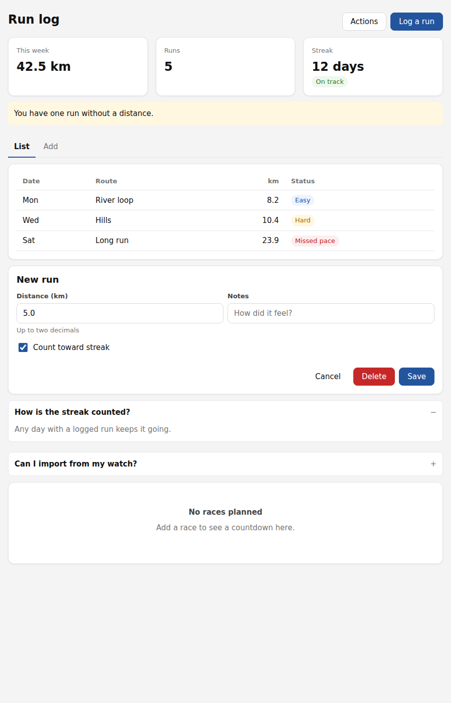
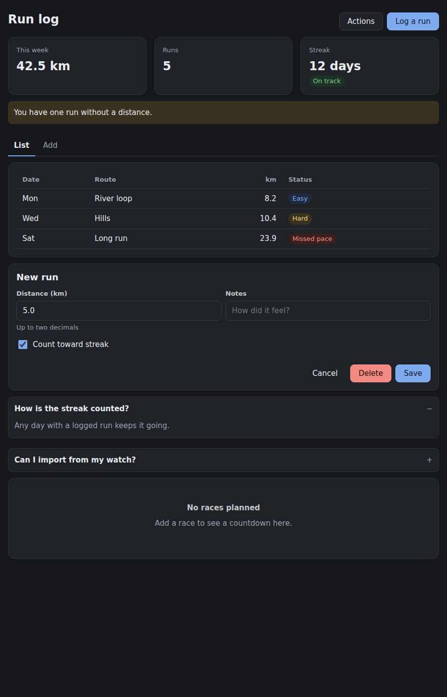

# Component kit (experimental)

Exh-61ix. A versioned set of design tokens and component styles that
artifacts share, so a library built over months reads as one interface: the
same buttons, cards, fields, dialogs and colors in every tool.

This is the first step of a larger design. Splitting large artifacts into
parts, a kit per library, and promoting an artifact's own components into the
kit come later and are not built here.




The page in the screenshots is [examples/kit-v1-demo.html](examples/kit-v1-demo.html).

## Pinning a version

An artifact opts in with one line in its `<head>`:

```html
<meta name="exhibit-kit" content="v1">
```

The stored body keeps only that line. Exhibit replaces it with the version's
stylesheet, as `<style data-exhibit-kit="v1">`, wherever the artifact leaves
storage:

- the render surface: the artifact, its widget, and its earlier versions
  (`internal/render`), and
- the export (`internal/export`), so the downloaded file is still one
  self-contained document with no dependency on any instance.

A body with no marker is untouched, so an artifact that never opted in renders
exactly as before. A marker naming a version that does not exist is left in
place, and does nothing in a browser. Markers are found with the HTML
tokenizer, so the same text inside a script, a style block or a comment is
ignored. A version pinned twice is inlined once.

A meta element was chosen because nothing fetches it: the network footprint
scanner reports no origin for it.

## Released versions never change

An artifact pinned to v1 a year ago must still render as it did then. So a
released version is never edited; a change to the kit is a new directory,
`internal/kit/kits/v2`. `TestReleasedKitsAreImmutable` hashes every version's
files and fails if a released one changes.

Moving an artifact to a newer kit means editing its marker. That edit is an
ordinary source change, so it becomes a new version of the artifact and can
be undone with a restore.

## What a version contains

```
internal/kit/kits/v1/
  manifest.json        description, tokens, components (classes, usage)
  tokens.css           --kit-* custom properties, light and dark
  base.css             zero-specificity element defaults, two utilities
  components/*.css     one file per component in the manifest
```

The assembled stylesheet is tokens, then base, then components in manifest
order, all inside `@layer exhibit-kit`. Unlayered styles always beat layered
ones, so any CSS the artifact writes overrides the kit, whatever its
specificity. An artifact restyles the kit by redefining a token on `:root` or
adding a rule; it never needs `!important`.

v1 is CSS only. Interactive pieces use native HTML rather than script:
`<dialog>` opened with `commandfor`/`command="show-modal"`, `<details>`, the
`popover` attribute, and tabs built from radio inputs and `:has()`. A later
version may add components with behavior as custom elements, each an optional
`.js` file beside its `.css`.

Components (v1): `layout`, `button`, `card`, `field`, `badge`, `dialog`,
`disclosure`, `menu`, `tabs`, `table`, `empty`. The manifest is the reference.
`TestEveryKitIsConsistentWithItsManifest` checks that every stylesheet is
listed and every documented class is defined.

### Widgets

A widget may pin the same version as its artifact. The kit's base gives `body`
a background, but the widget's own base stylesheet is unlayered, so it wins and
the tile stays transparent on its card.

## The agent

Two read-only tools, both backed by `GET /api/kit` routes (see `api.md`):

- `list_kit([version])` returns the marker to copy, the tokens, and each
  component's classes and example markup. No CSS, so it stays small however
  big the kit grows.
- `get_kit_component(name[, version])` returns one component's stylesheet.

The kit is instance-wide data Exhibit ships, identical for every caller, so an
agent session credential may read these routes even though it can reach
nothing else outside its one artifact.

The system prompt tells the agent to build new artifacts with the latest kit,
to prefer a kit class, then a native element, then custom CSS or script, to
style anything else from the kit's tokens, and to leave an existing
artifact's pinned version (or its lack of one) alone unless the user asks.
