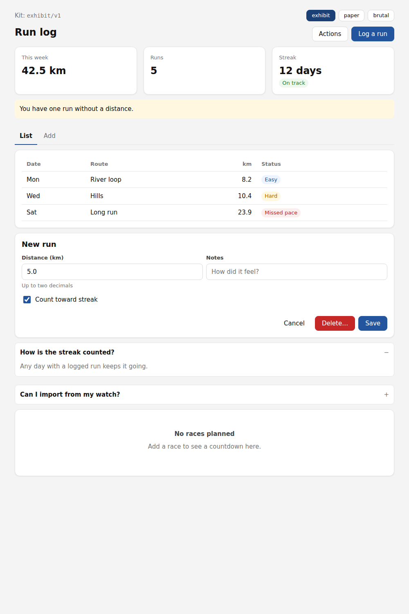
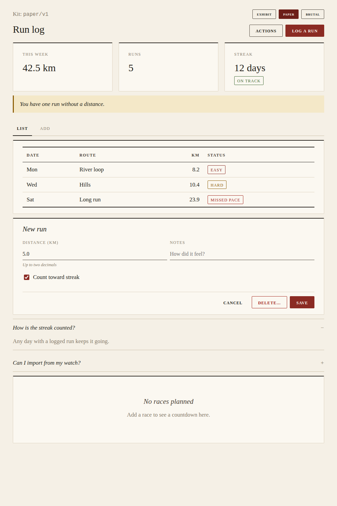
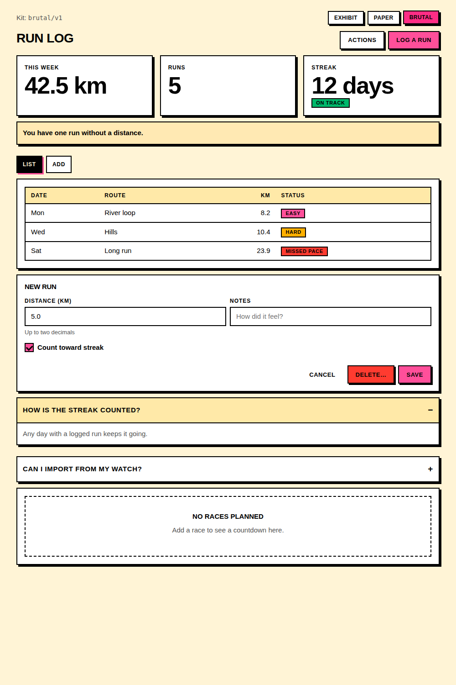
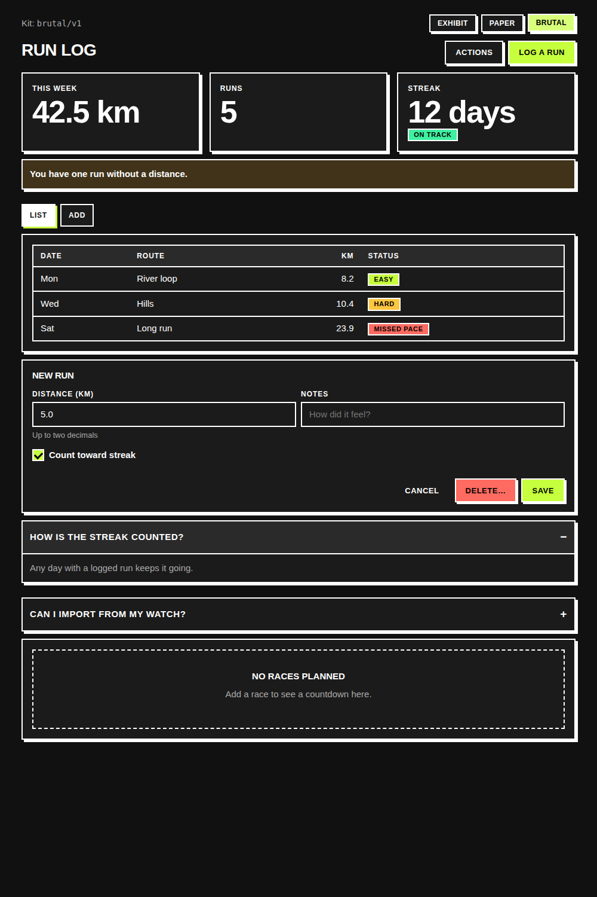

# Component kits (experimental)

Exh-61ix. Named, versioned sets of design tokens and component styles that
artifacts share, so a library built over months reads as one interface: the
same buttons, cards, fields, dialogs and colors in every tool.

This is the first step of a larger design. Splitting large artifacts into
parts, choosing a kit per library, and promoting an artifact's own components
into a kit come later and are not built here.

Three kits ship, all implementing contract v1. The same markup under each:






The page in the screenshots is [examples/kit-showcase.html](examples/kit-showcase.html).
It pins all three kits and switches between them, which a real artifact would
not do.

## Pinning a kit

An artifact opts in with one line in its `<head>`:

```html
<meta name="exhibit-kit" content="exhibit/v1">
```

The stored body keeps only that line. Exhibit replaces it with the kit's
stylesheet, as `<style data-exhibit-kit="exhibit/v1">`, wherever the artifact
leaves storage:

- the render surface: the artifact, its widget, and its earlier versions
  (`internal/render`), and
- the export (`internal/export`), so the downloaded file is still one
  self-contained document with no dependency on any instance.

A body with no marker is untouched, so an artifact that never opted in renders
exactly as before. A marker naming a kit that does not exist is left in place,
and does nothing in a browser. Markers are found with the HTML tokenizer, so
the same text inside a script, a style block or a comment is ignored. A kit
pinned twice is inlined once; several different kits are each inlined, in
order.

A meta element was chosen because nothing fetches it: the network footprint
scanner reports no origin for it.

## Contracts: why kits are interchangeable

A kit is two things that change at different rates:

- **the contract**, what an artifact writes: component names, their classes,
  the markup each expects, and the token names (`--kit-color-accent`, …) an
  artifact may style its own rules with. `internal/kit/contracts/v1.json`.
- **the look**, how that markup is drawn: one stylesheet per kit.

Every kit names the contract it implements. Markup written against contract v1
works under any v1 kit, so moving an artifact from `exhibit/v1` to
`paper/v1` is a one-line edit to its marker and changes nothing else.
`TestEveryKitImplementsItsContract` holds that: every kit defines every
documented class, has one stylesheet per component and nothing undocumented,
defines every token it reads, and defines exactly the same token names as the
other kits on its contract.

The agent reads the contract, not a kit, which is why `list_kit` lists the
contract once however many kits implement it.

## Released kits never change

An artifact pinned to `paper/v1` a year ago must still render as it did then.
So released kits and contracts are never edited. A new look is a new kit
directory (`kits/<name>/v1`); a change to an existing look is a new version
(`kits/paper/v2`); a change to what artifacts write is a new contract.
`TestReleasedKitsAreImmutable` hashes every kit and contract and fails if a
released one changes.

Changing an artifact's kit means editing its marker. That edit is an ordinary
source change, so it becomes a new version of the artifact and can be undone
with a restore.

## What a kit contains

```
internal/kit/
  contracts/v1.json        components (classes, usage), tokens, base utilities
  kits/<name>/<version>/
    manifest.json          name, version, contract, description of the look
    tokens.css             --kit-* custom properties, light and dark
    base.css               zero-specificity element defaults, two utilities
    components/*.css       one file per component in the contract
```

The assembled stylesheet is tokens, then base, then components in contract
order, all inside `@layer exhibit-kit`. Unlayered styles always beat layered
ones, so any CSS the artifact writes overrides the kit, whatever its
specificity. An artifact restyles a kit by redefining a token on `:root` or
adding a rule; it never needs `!important`.

The default kit, the one new artifacts pin unless the user asks for another,
is the newest version of `exhibit` (`kit.Default`).

Kits are CSS only. Interactive pieces use native HTML rather than script:
`<dialog>` opened with `commandfor`/`command="show-modal"`, `<details>`, the
`popover` attribute, and tabs built from radio inputs and `:has()`. A later
contract may add components with behavior as custom elements, each an
optional `.js` file beside its `.css`.

Components (contract v1): `layout`, `button`, `card`, `field`, `badge`,
`dialog`, `disclosure`, `menu`, `tabs`, `table`, `empty`. The contract is the
reference.

Kits (contract v1):

| Kit | Look |
|-----|------|
| `exhibit/v1` | Exhibit's own: neutral grey ground, white rounded cards, a calm blue accent, system sans-serif. The default. |
| `paper/v1` | Editorial: cream paper, serif type, hairline rules instead of shadows, small-caps labels, oxblood accent. |
| `brutal/v1` | Neo-brutalist: heavy outlines, hard offset shadows, square corners, bold uppercase controls, a loud accent. |

All three follow the system light and dark setting.

### Widgets

A widget may pin the same kit as its artifact. A kit's base gives `body` a
background, but the widget's own base stylesheet is unlayered, so it wins and
the tile stays transparent on its card.

## The agent

Two read-only tools, both backed by `GET /api/kit` routes (see `api.md`):

- `list_kit([kit])` lists every kit with the marker that pins it, then the
  contract the named kit (default: the default kit) implements: tokens, and
  each component's classes and example markup. No CSS, so it stays small
  however many kits there are.
- `get_kit_component(name[, kit])` returns one component's stylesheet in a kit.

The kits are instance-wide data Exhibit ships, identical for every caller, so
an agent session credential may read these routes even though it can reach
nothing else outside its one artifact.

The system prompt tells the agent to build new artifacts with the default kit
unless the user asks for another look, to prefer a kit class, then a native
element, then custom CSS or script, to style anything else from the kit's
tokens, and to leave an existing artifact's kit (or its lack of one) alone
unless the user asks. Asked to change kit, it changes the marker and nothing
else.
