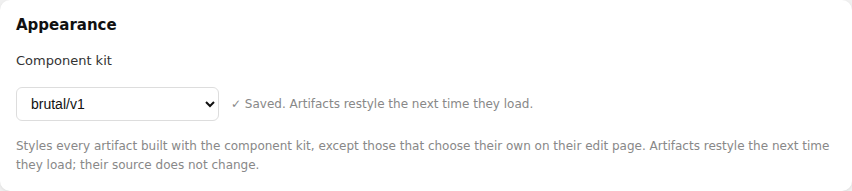
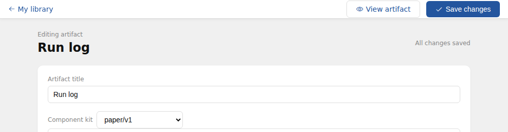

# Component kits (experimental)

Exh-61ix. Named, versioned sets of design tokens and component styles that
artifacts share, so a library built over months reads as one interface: the
same buttons, cards, fields, dialogs and colors in every tool.

This is the first step of a larger design. Splitting large artifacts into
parts, choosing a kit per library, and promoting an artifact's own components
into a kit come later and are not built here.

Three kits ship, all implementing contract v1. The same source under each:


The page in the screenshots is [examples/kit-showcase.html](examples/kit-showcase.html),
unchanged between them: only the kit setting differs.

## Using the kit

An artifact opts in with one line in its `<head>`, naming the kit *contract*
its markup is written against:

```html
<meta name="exhibit-kit" content="v1">
```

That is all the source says. **Which kit draws it is not in the source.** It is
chosen outside, at two levels, and resolved on every request (`kit.Resolve`):

1. the artifact's own kit setting (`artifacts.kit`, on its edit page or
   `PATCH /api/artifacts/:id {"kit": "paper/v1"}`), else
2. its owner's library kit (`library_settings.kit`, on the profile page or
   `PUT /api/settings/kit`), else
3. the default kit, the newest `exhibit`.




A choice that names a kit on another contract falls to the newest version of
that kit on the artifact's contract, and a choice that resolves to nothing
falls to the next level, so a render never fails for want of a kit.

Exhibit replaces the marker with the resolved kit's stylesheet, as
`<style data-exhibit-kit="paper/v1">`, wherever the artifact leaves storage:

- the render surface: the artifact, its widget, and its earlier versions
  (`internal/render`), and
- the export (`internal/export`), so the downloaded file is still one
  self-contained document with no dependency on any instance. It carries the
  kit that applied when it was exported.

Consequences of the look living outside the source, all deliberate:

- **Changing a kit restyles without an edit.** No source changes, so no
  version is made, and the agent's view of the artifact is untouched.
- **History does not record the look**, like the network allowlist and the
  capability approvals. Viewing or restoring an old version shows it in the
  kit chosen now.
- **A shared artifact looks the way its owner chose.** The owner's library kit
  applies, not the recipient's, so everyone sees one artifact.
- **Duplicating copies the artifact's own kit choice**, like its other settings.

A body with no marker is untouched, so an artifact that never opted in renders
exactly as before. A marker naming a contract that does not exist is left in
place, and does nothing in a browser. Markers are found with the HTML
tokenizer, so the same text inside a script, a style block or a comment is
ignored. A contract named twice is inlined once.

A meta element was chosen because nothing fetches it: the network footprint
scanner reports no origin for it.

## Contracts: why kits are interchangeable

A kit is two things that change at different rates:

- **the contract**, what an artifact writes: component names, their classes,
  the markup each expects, and the token names (`--kit-color-accent`, …) an
  artifact may style its own rules with. `internal/kit/contracts/v1.json`.
- **the look**, how that markup is drawn: one stylesheet per kit.

Every kit names the contract it implements, and any kit on an artifact's
contract can draw it. `TestEveryKitImplementsItsContract` holds that: every
kit defines every documented class, has one stylesheet per component and
nothing undocumented, defines every token it reads, and defines exactly the
same token names as the other kits on its contract.
`TestEveryContractHasADefaultKit` makes sure the fallback always exists.

The agent writes against the contract, not a kit, which is why `list_kit`
leads with the contract.

## Released kits never change

An artifact drawn with `paper/v1` must look the same until someone chooses
otherwise. So released kits and contracts are never edited. A new look is a new kit
directory (`kits/<name>/v1`); a change to an existing look is a new version
(`kits/paper/v2`); a change to what artifacts write is a new contract.
`TestReleasedKitsAreImmutable` hashes every kit and contract and fails if a
released one changes.

A new version of a kit is opted into like any other kit, by choosing it.

## What a kit contains

```
internal/kit/
  contracts/v1.json        components (classes, usage), tokens, base utilities
  kits/<name>/<version>/
    manifest.json          name, version, contract, description of the look
    tokens.css             --kit-* custom properties, light and dark
    base.css               zero-specificity element defaults, two utilities
    components/*.css       one file per component in the contract
```

The assembled stylesheet is tokens, then base, then components in contract
order, all inside `@layer exhibit-kit`. Unlayered styles always beat layered
ones, so any CSS the artifact writes overrides the kit, whatever its
specificity. An artifact restyles a kit by redefining a token on `:root` or
adding a rule; it never needs `!important`.

The default kit, the one used when neither the artifact nor its library chose
one, is the newest version of `exhibit` (`kit.Default`).

Kits are CSS only. Interactive pieces use native HTML rather than script:
`<dialog>` opened with `commandfor`/`command="show-modal"`, `<details>`, the
`popover` attribute, and tabs built from radio inputs and `:has()`. A later
contract may add components with behavior as custom elements, each an
optional `.js` file beside its `.css`.

Components (contract v1): `layout`, `button`, `card`, `field`, `badge`,
`dialog`, `disclosure`, `menu`, `tabs`, `table`, `empty`. The contract is the
reference.

Kits (contract v1):

| Kit | Look |
|-----|------|
| `exhibit/v1` | Exhibit's own: neutral grey ground, white rounded cards, a calm blue accent, system sans-serif. The default. |
| `paper/v1` | Editorial: cream paper, serif type, hairline rules instead of shadows, small-caps labels, oxblood accent. |
| `brutal/v1` | Neo-brutalist: heavy outlines, hard offset shadows, square corners, bold uppercase controls, a loud accent. |

All three follow the system light and dark setting.

### Widgets

A widget may use the same marker as its artifact and is drawn with the same
kit. A kit's base gives `body` a
background, but the widget's own base stylesheet is unlayered, so it wins and
the tile stays transparent on its card.

## The agent

Three tools, all backed by the API (see `api.md`):

- `list_kit([contract])` returns the contract's marker, its tokens, and each
  component's classes and example markup, then the kits that can draw it. No
  CSS, so it stays small however many kits there are.
- `get_kit_component(name[, kit])` returns one component's stylesheet in a kit.
- `set_artifact_kit(kit)` sets the session's artifact's kit setting, or clears
  it with `""`. It changes no source and makes no version; the preview
  re-renders.

The kits are instance-wide data Exhibit ships, identical for every caller, so
an agent session credential may read `/api/kit…` even though it can reach
nothing else outside its one artifact. The library kit is the owner's data and
lives at `/api/settings/kit`, which an agent cannot reach.

The system prompt tells the agent to write new artifacts against the kit
contract and never pick a look in the source; to prefer a kit class, then a
native element, then custom CSS or script; to style anything else from the
kit's tokens, so it changes with the kit; to use `set_artifact_kit` when the
user asks for a different look for this artifact; and to leave an artifact
that never used the kit alone unless asked.
