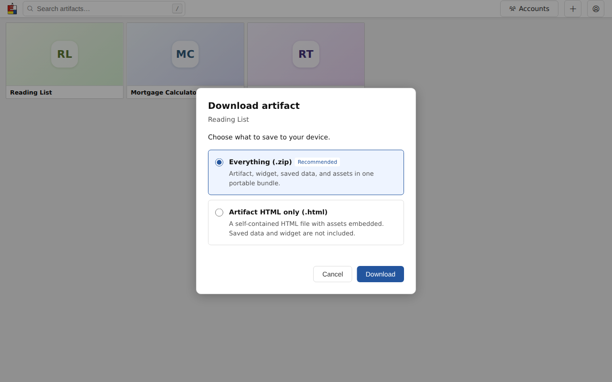

# Reusable UI components

A reusable gallery component consists of a Go template partial, shared CSS, and
a Stimulus controller. Go owns markup and data. Stimulus owns browser-only
interaction and lifecycle. htmx swaps server-rendered regions after mutations.

## Loading and registration

Include `{{template "componentScripts"}}` once in a full app page using shared
controllers. It loads `/assets/gallery/controllers.js` as a native ES module.
That entry point starts one application and explicitly registers controllers.
Relative imports resolve on the app origin. Fragments contain markup only;
inserting `data-controller` markup connects its controller automatically.

Stimulus is pinned in `web/stimulus/package.json`. `make assets` copies its ES
module and MIT license into the embedded assets. The gallery remains unbundled,
and production needs no Node process or external asset service.

## Defining action menus

A feature supplies an `actionMenuView`. Two different menus can be defined as:

```go
artifactActions := actionMenuView{
    ID: "artifact-actions-" + artifact.ID,
    Label: "Actions for " + artifact.Title,
    Items: []actionMenuItem{
        menuLink("Edit", "ph-pencil-simple", "/artifacts/"+artifact.ID+"/edit"),
        menuEvent("Duplicate", "ph-copy", "exhibit:duplicate",
            map[string]string{"artifactID": artifact.ID, "title": artifact.Title}),
    },
}

collectionActions := actionMenuView{
    ID: "collection-actions-" + collection.ID,
    Label: "Actions for " + collection.Name,
    Items: []actionMenuItem{
        menuLink("View collection", "ph-folder", "/collections/"+collection.ID),
        menuEvent("Rename", "ph-pencil-simple", "exhibit:rename-collection",
            map[string]string{"collectionID": collection.ID}),
    },
}
```

The collection routes and event illustrate a future consumer. Each feature
implements the routes and events it offers. Pass these values in the page view
model and render them using the same partial:

```html
{{template "actionMenu" .ArtifactActions}}
{{template "actionMenu" .CollectionActions}}
```

IDs must be unique in the document, including across paged fragments. `Label`
names the trigger and menu for assistive technology. `Icon` is an optional
self-hosted Phosphor class. Optional `Class`, `TriggerClass`, and `PanelClass`
adapt appearance and placement; the gallery retains its compact upward-opening
card menu. The default menu opens below its trigger.

`menuLink` renders an ordinary anchor. `menuEvent` renders a button dispatching
its named, bubbling event with the string payload in `event.detail`.
`detail.trigger` is the visible trigger for returning focus after a modal.
Payload JSON is escaped by `html/template` and decoded by Stimulus.

Feature code listens on its stable region:

```js
root.addEventListener('exhibit:rename-collection', event => {
  // Open the feature dialog using event.detail.collectionID.
  // Return focus to event.detail.trigger when it closes.
});
```

The controller handles toggling, dismissal, one open menu per document, arrow
keys, Home/End, typeahead, Tab exit, and Escape focus restoration. Features own
API calls and refresh events. Gallery duplication listens for
`exhibit:duplicate`; its form still uses `apiFetch` and requests its htmx refresh
with `exhibit:artifacts-changed`.


[Phone layout](screenshots/Exh-16ds/02-gallery-action-menu-mobile.png)

## Adding a controller

1. Add a native module under `web/gallery/` importing `Controller` from
   `../stimulus/stimulus.js`. Register it in `controllers.js` and add its file
   to `web/gallery/build.mjs`.
2. Define markup in a named Go partial. Use scoped targets for elements, values
   for configuration, and actions for events. Shared styles use design tokens.
3. Keep browser-only state on the controller. Keep its root stable when an
   htmx update must preserve that state. Replacing the root creates a new
   instance and does not automatically preserve an unsaved working copy.
4. Use `connect()` for per-connection setup and `disconnect()` to release timers,
   observers, and subscriptions. Stimulus manages `data-action` listeners.
5. Features perform authenticated API calls and emit the existing change events
   that htmx regions listen for. Controllers do not rebuild server markup.

## Artifact download dialog

The `artifactDownloadDialog` Go partial, `.artifact-download-*` shared styles,
and `artifact-download` Stimulus controller form one reusable native `<dialog>`.
The host stays outside the gallery results region so htmx card replacements
and appends keep one dialog. The owner detail page uses the same component.
Read-only pages omit its host and markup; server-rendered read-only gallery
fragments omit the download action too.

Gallery menus dispatch `exhibit:download` with `artifactID`, `title` and their
visible `trigger`. A stable host handles it with
`data-action="exhibit:download->artifact-download#open"`. A direct button can use
`data-action="artifact-download#open"`, the `artifact-id` and `trigger-id` action
parameters, and `data-artifact-download-title` (plain text, preserving titles
that look like JSON). The detail menu supplies `pip-more` as its return trigger
because the selected menu item is hidden when the menu closes.

Both format choices are server markup. Everything (.zip) is selected and focused
on every opening; Artifact HTML only (.html) retains the self-contained document
download. The controller calls `apiFetch` through `api-module.js` with explicit
`?format=zip` or `?format=html`, then uses `downloadBlob` and the server filename.
It never rebuilds the dialog or card markup. Stored state JSON and assets ZIP
remain independent exports.

Native dialog supplies focus containment and an inert background. Escape,
backdrop and Cancel share the pending guard: while the response and its blob are
being read, formats and buttons are disabled, dismissal is refused, and repeated
submissions send no second request. Errors are announced in the dialog with a
Try again button and preserve the selected format. Success or cancellation
restores focus to the visible trigger; reopening resets errors and ZIP selection.
Disconnect aborts a pending read and closes the dialog.



[Gallery on a phone](screenshots/Exh-zlsl/02-gallery-download-mobile.png) ·
[Artifact viewer](screenshots/Exh-zlsl/03-detail-download-desktop.png) ·
[Artifact viewer on a phone](screenshots/Exh-zlsl/04-detail-download-mobile.png)

## Testing

The existing Node suite tests feature logic in its small DOM. Stimulus
integration uses a real browser through the existing `chromiumtest` helper:

```sh
make assets
go test ./internal/api -run 'Test(ActionMenuBrowser|GalleryActionMenuDuplicationBrowser|ArtifactDownloadBrowser|ArtifactDownloadControls)$' -count=1
```

The helper finds a locally installed Playwright Chromium headless shell, or
uses `CHROMIUM_TEST_BINARY`. It skips browser tests when neither is available.
Cases cover two different menus, escaped payloads, keyboard/focus, actual htmx
replacements and appends, disconnect/reconnect, and the existing duplication
dialog. Download coverage includes both formats, credentials, keyboard/focus,
all dismissals, pending guards, HTTP/body-read failures and retry, htmx append
and replacement, disconnect/reconnect, detail controls, and a phone viewport.
Add browser integration cases for new controllers; keep the miniature
Node DOM focused on feature logic.
