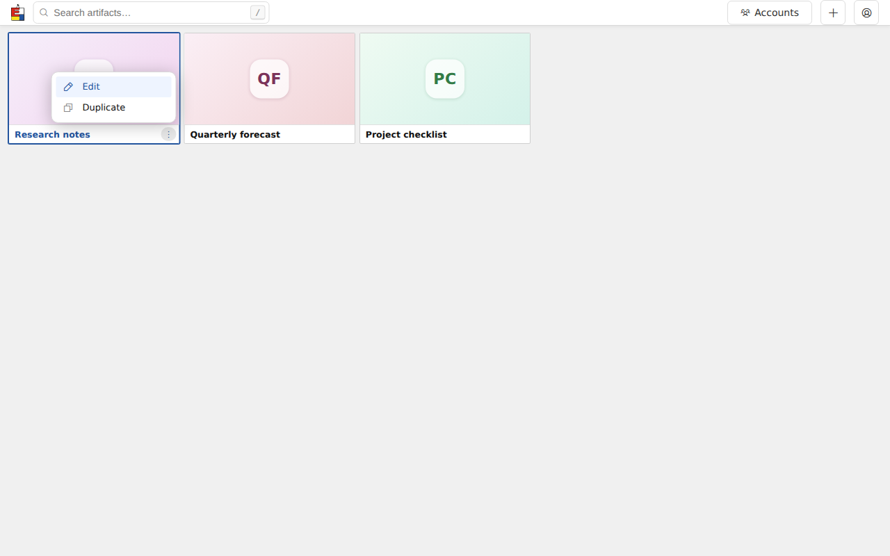
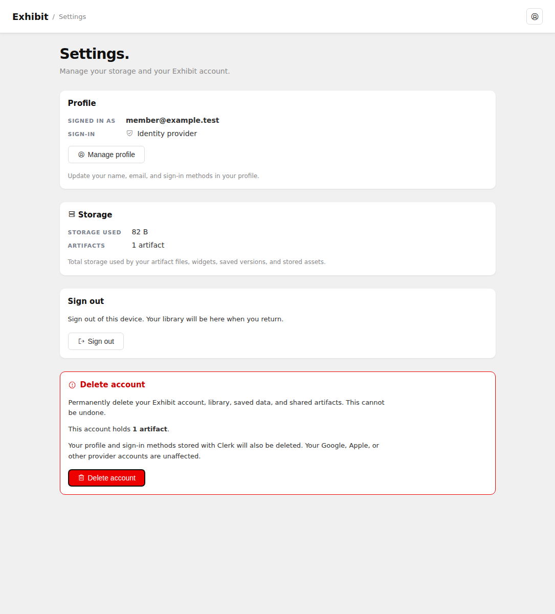

# Reusable UI components

A reusable gallery component consists of a Go template partial, shared CSS, and
a Stimulus controller. Go owns markup and data. Stimulus owns browser-only
interaction and lifecycle. htmx swaps server-rendered regions after mutations.

## Loading and registration

Include `{{template "componentScripts"}}` once in a full app page using shared
controllers. It loads `/assets/gallery/controllers.js` as a native ES module.
That entry point starts one application and explicitly registers controllers.
Relative imports resolve on the app origin. Fragments contain markup only;
inserting `data-controller` markup connects its controller automatically.

Stimulus is pinned in `web/stimulus/package.json`. `make assets` copies its ES
module and MIT license into the embedded assets. The gallery remains unbundled,
and production needs no Node process or external asset service.

## App header

Every full-document app page renders `{{template "appHeader" .Header}}` from
`templates/components.tmpl`: gallery and shared-library views, Settings,
artifact editor and viewer, account administration, agent, add-artifact,
not-found, and both local and hosted authentication pages.
`appHeaderView` in `internal/api/appheader.go` supplies page-owned content.
The default variant provides a title, optional logo/back link/search, and
native link or button actions. Route guards enforce permission independently.
The gallery and hosted Settings retain the shared `accountControl` menu,
including its recovery link. Authentication pages supply branding and their
page title without signed-in navigation or account controls; local sign-in
remains scriptless.

For a title and return to the gallery, populate the page's `Header` with
`subpageHeader("Page title")`. For a different destination, supply
`Back: &appHeaderBack{URL: destination, Label: destinationName}`. Set
`CollapseLabel` when the return label should become visually hidden on phones;
otherwise long labels truncate. `HideTitle` keeps a gallery heading available
to assistive technology without drawing it beside the logo.

Each `appHeaderAction` has a `Label` and self-hosted Phosphor `Icon`. `Href`
makes an anchor; otherwise it renders a button with an optional `ID`.
`LabelID` identifies a label that a feature updates, such as the agent key
status. An optional `TitleIcon` decorates the page title.
`IconOnly` hides the visible label at every width; other action labels become
visually hidden at 600px and below. Accessible names and tooltips remain.
`Primary` selects the primary button style. The editor's `SaveEditor` flag
retains its existing `data-save-editor` binding and unsaved-changes workflow.
Gallery search and filter markup stays in `galleryHeaderSearch`; its existing
Stimulus and htmx behavior remains attached to the stable gallery root.

`.app-header` and its child classes in `components.css` own the layout, including
when the bar is nested inside a gallery controller. The baseline is the
rendered gallery: 37px tall with 36px icon controls on desktop; 33px tall with
32px controls at 767px and below, plus any phone top safe-area inset. Horizontal
padding is 16px (8px at 360px and below), with 12px gaps. The gallery filter
layout tightens gaps on narrow screens. Page styles only extend feature layout,
not the bar's dimensions. `--header-height` supplies the shared minimum height;
the bar grows when account-service errors need more room. Hidden account recovery links remain
hidden until their controller reveals them.

The artifact viewer uses the `Floating` variant, populated by
`artifactHeader`. Its `floatingHeaderView` carries the title, created date,
posture, and which owner actions are available. `floatingAppHeader` owns the
pill, both popups, restore tab, and accessibility announcements; its styles
live in `components.css`. The `floating-header` Stimulus controller connects
`connectFloatingHeader` from `pip.js` and releases all listeners, observers,
timers, and animation frames on disconnect. Dragging, docking, hiding,
restoring, remembered placement, popup dismissal, and keyboard behavior are
preserved. The artifact still fills the viewport beneath these controls.

Standard headers need no new browser controller. Features compose their
existing controllers and native events. A template audit guards every full
app document against bypassing this component. Browser coverage includes the
standard pages at six widths, authentication pages without signed-in controls,
and floating-header interactions and disconnect/reconnect.

[Desktop gallery](screenshots/Exh-arf2/gallery-desktop.png) ·
[Phone gallery](screenshots/Exh-arf2/gallery-phone.png) ·
[Account](screenshots/Exh-arf2/account-desktop.png) ·
[Editor](screenshots/Exh-arf2/editor-desktop.png) ·
[Accounts](screenshots/Exh-arf2/admin-desktop.png) ·
[Add artifact](screenshots/Exh-arf2/new-desktop.png) ·
[Agent](screenshots/Exh-arf2/agent-desktop.png) ·
[Not found](screenshots/Exh-arf2/notfound-desktop.png) ·
[Viewer](screenshots/Exh-arf2/viewer-desktop.png) ·
[Sign in](screenshots/Exh-arf2/login-desktop.png)

## Defining action menus

A feature supplies an `actionMenuView`. Two different menus can be defined as:

```go
artifactActions := actionMenuView{
    ID: "artifact-actions-" + artifact.ID,
    Label: "Actions for " + artifact.Title,
    Items: []actionMenuItem{
        menuLink("Edit", "ph-pencil-simple", "/artifacts/"+artifact.ID+"/edit"),
        menuEvent("Duplicate", "ph-copy", "exhibit:duplicate",
            map[string]string{"artifactID": artifact.ID, "title": artifact.Title}),
    },
}

collectionActions := actionMenuView{
    ID: "collection-actions-" + collection.ID,
    Label: "Actions for " + collection.Name,
    Items: []actionMenuItem{
        menuLink("View collection", "ph-folder", "/collections/"+collection.ID),
        menuEvent("Rename", "ph-pencil-simple", "exhibit:rename-collection",
            map[string]string{"collectionID": collection.ID}),
    },
}
```

The collection routes and event illustrate a future consumer. Each feature
implements the routes and events it offers. Pass these values in the page view
model and render them using the same partial:

```html
{{template "actionMenu" .ArtifactActions}}
{{template "actionMenu" .CollectionActions}}
```

IDs must be unique in the document, including across paged fragments. `Label`
names the trigger and menu for assistive technology. `Icon` is an optional
self-hosted Phosphor class. Optional `Class`, `TriggerClass`, and `PanelClass`
adapt appearance and placement; the gallery retains its compact upward-opening
card menu. The default menu opens below its trigger.

`menuLink` renders an ordinary anchor. `menuEvent` renders a button dispatching
its named, bubbling event with the string payload in `event.detail`.
`detail.trigger` is the visible trigger for returning focus after a modal.
Payload JSON is escaped by `html/template` and decoded by Stimulus.

Feature code listens on its stable region:

```js
root.addEventListener('exhibit:rename-collection', event => {
  // Open the feature dialog using event.detail.collectionID.
  // Return focus to event.detail.trigger when it closes.
});
```

The controller handles toggling, dismissal, one open menu per document, arrow
keys, Home/End, typeahead, Tab exit, and Escape focus restoration. Features own
API calls and refresh events. Gallery duplication listens for
`exhibit:duplicate`; its form still uses `apiFetch` and requests its htmx refresh
with `exhibit:artifacts-changed`.



[Phone layout](screenshots/Exh-16ds/02-gallery-action-menu-mobile.png)

## Adding a controller

1. Add a native module under `web/gallery/` importing `Controller` from
   `../stimulus/stimulus.js`. Register it in `controllers.js` and add its file
   to `web/gallery/build.mjs`.
2. Define markup in a named Go partial. Use scoped targets for elements, values
   for configuration, and actions for events. Shared styles use design tokens.
3. Keep browser-only state on the controller. Keep its root stable when an
   htmx update must preserve that state. Replacing the root creates a new
   instance and does not automatically preserve an unsaved working copy.
4. Use `connect()` for per-connection setup and `disconnect()` to release timers,
   observers, and subscriptions. Stimulus manages `data-action` listeners.
5. Features perform authenticated API calls and emit the existing change events
   that htmx regions listen for. Controllers do not rebuild server markup.

## Native modal dialogs

The registered `modal` controller connects the dialog module in `modal.js`.
Native `<dialog>` supplies the top layer and inert background. Keep the root
outside any htmx region whose refresh must preserve its working copy. Feature
Go partials own native fields and labels; `.modal-dialog` supplies visual defaults,
including associated `label[for]` captions (also inside native forms and
fieldsets), `.modal-error`, and `.modal-actions` footers.
Migrated dialogs use the component defaults for the frame, 16px heading,
13px body copy, field captions/controls/focus ring, and wrapping action footer
with an 8px gap and 18px top spacing. Do not copy these into page styles.
Use `label[for]` for captions and `.modal-check` for a wrapping checkbox label;
an optional `small` inside its text holds a description. The two roles must
not share caption styling. Read-only fields and disabled controls have shared
states. Footer buttons and checkbox rows have a 44px minimum height on phones.
Errors use `.modal-error`; a progress status uses ordinary body typography.

`checkModalVisuals` compares rendered native dialogs with a plain shared
reference under the same page styles at desktop and phone sizes. It checks
heading/body/caption/field/checkbox/footer/error styles and horizontal overflow,
without assuming that every dialog has the same content geometry.

[Duplicate desktop](screenshots/Exh-p3ah/duplicate/1280.png) ·
[Duplicate phone](screenshots/Exh-p3ah/duplicate/390.png)

No lifecycle action list is needed:

```html
<dialog class="modal-dialog" aria-labelledby="example-title" data-controller="modal">
  <h2 id="example-title">Edit example</h2>
  <input aria-label="Name" autofocus>
  <button type="button" data-modal-dismiss>Cancel</button>
</dialog>
```

Import `modalFor` from `./modal.js` and keep its stable handle:

```js
const editor = modalFor(dialog);
// Populate feature fields, then open with the visible return-focus element.
editor.show(trigger);
const saved = await editor.run(async () => {
  // Validate/send the feature request and display feature errors here.
  return saveFeature();
});
if (saved) editor.close();
```

The interface has three methods and one read/write value:

- `show(trigger)` opens synchronously and returns whether it opened. Native
  `autofocus` chooses initial focus. Omit the trigger to use the active element.
  Opening does not depend on Stimulus startup or a document-wide element ID.
- `close()` returns whether dismissal was accepted. Escape, backdrop, and
  `data-modal-dismiss` use this same path, including synchronous return focus.
  Padding remains content. Tab and Shift+Tab wrap between enabled fields.
- `run(operation)` immediately calls the operation once, blocks duplicate runs
  and dismissal until its promise settles, and restores each button/fieldset's
  original disabled state. A native fieldset locks a whole form when needed;
  ordinary inputs remain editable. No values are reset. Errors propagate to
  the feature. It returns the operation's result, or `undefined` for a duplicate
  run or an operation invalidated by removal of the dialog.
- `pending` reads the shared lock. Set it to `true` when event-driven work
  starts and `false` from its existing completion/failure handlers. `run` owns
  the same lock for promise-based work.

Removing the dialog releases native modal state, listeners, pending controls,
and return focus. One `modal:disconnected` lifecycle event lets permission
features deny or drop their exact request and close unused placeholder tabs;
it performs no mutation and never restores a detached trigger. Reconnecting reuses the same handle;
an old completion cannot unlock a new operation. The feature still owns any
network request and its effects; removal does not cancel an API mutation.

`pending = true` / `pending = false` applies the same lock for event-driven
work whose completion already arrives through htmx. Do not wrap those events
in a synthetic Promise.

Optional feature escape hatches are cancellable `modal:before-close` and
`modal:closed` events. The before-close event includes `detail.reason`;
backdrop-only domain decisions can veto `backdrop` without adding a configuration
flag or duplicating native listeners. Use these hooks for domain decisions or cleanup, not generic
busy handling. Duplicate uses `run` for in-flight work and retains only its uncertain-retry
payload lock: title/options stay fixed until the server confirms or refuses the
request. Buttons and dismissal use the shared pending lock. No old
`exhibit:modal-open`/`exhibit:modal-close` event interface is retained.

Features own errors, API calls, refresh events, and focus selection after an
htmx replacement. They never rebuild server markup. All thirteen application-owned dialog implementations and Duplicate use this
handle. Native top-layer ordering owns Escape; features add neither a document
keyboard trap nor manual background inertness. Browser-owned prompts and Clerk
dialogs retain their own behavior.

## Gallery lifecycle and navigation

The stable `#gallery-shell` uses the registered `gallery` controller. It owns
space request generations, history restoration and the current search
connection. Its `space` target is `#gallery-content`, which gets replaced when
switching My library, Shared with me or Shared by me. The server sends the
`gallerySpaceContent` partial plus an out-of-band `gallerySearchRegion` update.
Keep the header and Clerk controller outside both regions.

Each content root uses `gallery-space`. Its connection initializes widget
visibility, duplication and edit-return behavior; disconnect releases their
observers, listeners and timers. `event-scope.js` groups explicit listener
cleanup, including listeners on a stable ancestor. Pending mutations may
finish on the server after disconnect, but their callbacks cannot refresh or
focus a different space. The new destination always reloads its data.

The `filter-sheet` controller lives on the shell so header triggers and the
content dialog share a scope. Its targets may disappear when a space has no
filters. Search/filter htmx swaps keep the dialog itself while updating its
options; a full space switch replaces it along with the content.

Run the actual navigation and lifecycle checks with:

```sh
make assets
go test ./internal/api -run 'TestGallerySpace(Navigation.*Browser|Fragments|FragmentExpiredSession)$' -count=1
go test -tags screenshot ./internal/api -run '^TestCaptureGallerySpaceNavigation$' -count=1
```

The browser suite uses the real htmx, Stimulus and Clerk loader/controller
against local SDK doubles. It checks document/header/account node identity,
load/reload/mount counts, history, permissions, duplication, widget remounts,
request races, failures, modified clicks and no-JS links. Screenshot capture
uses `shot-scraper` and verifies header identity after a real space click.

## Unsaved changes

The editor's body uses the registered `unsaved-changes` controller with the
`editorLeaveDialog` partial. Its `dialog` target composes the shared modal for focus
containment; its `status` target reports whether there are unsaved edits.
Escape and Keep editing close the dialog and return focus to the link.
Browser reload, Back, and tab closure use the native beforeunload prompt.
Protection resets on pageshow when browser Back restores a cached editor.
Confirmed deletion and version restoration emit `exhibit:editor-exit` before
navigating, so they do not ask for the same discard decision twice.

Sections register `isDirty`, asynchronous `save`, and `discard` operations with
`editor-session.js`. A successful save returns `true`; a failed or incomplete
save leaves its error on the page and returns `false`. The coordinator shares
in-flight saves, stops on failure, and checks for further edits before allowing
navigation. It preserves server-confirmed changes after partial saves.
The source and widget section tracks the submitted snapshot, so text entered
while a request is pending remains unsaved. Section code emits
`exhibit:editor-changed` when its internal working copy changes without a form
input event; CodeMirror emits input on its underlying textarea.

## Testing

The existing Node suite tests feature logic in its small DOM. Stimulus
integration uses a real browser through the existing `chromiumtest` helper:

```sh
make assets
go test ./internal/api -run 'Test(AppHeaderBrowser|ActionMenuBrowser|GalleryActionMenuDuplicationBrowser)$' -count=1
```

The helper finds a locally installed Playwright Chromium headless shell, or
uses `CHROMIUM_TEST_BINARY`. It skips browser tests when neither is available.
Cases cover two different menus, escaped payloads, keyboard/focus, actual htmx
replacements and appends, disconnect/reconnect, and the existing duplication
dialog, including modal removal/reconnection. The full application journeys in
`e2e/` cover persisted state and Duplicate's save/htmx replacement, cancellation,
keyboard focus, pending-save guards, and retries after a committed response is
lost. These run in CI; local Playwright execution is explicit for relevant
frontend work or failure investigation. See [browser test setup](../e2e/README.md).
Add browser integration cases for new controllers; keep the miniature Node DOM
focused on feature logic.

## Account menu and Settings

The gallery and Settings header render the same `accountControl` template partial.
Hosted accounts have one Clerk user button. `clerk-menu.js` adds a Settings link
using Clerk's supported custom menu API. Clerk's Profile and Security screens
retain their standard content. Settings lives at `/settings` (`/profile` is a
compatibility alias) and offers storage usage, sign-out, and account deletion.
Its Manage profile button opens the unmodified Clerk profile modal. The Settings
header keeps that same account menu beside the Exhibit / Settings breadcrumb,
matching the approved interactive demo. Storage and artifact counts come from
the session owner, and the demo's sample data and simulated actions are confined
to `designs/settings-demo.html`.

The `account-deletion` controller is shared by hosted and self-hosted settings.
It reveals the server-rendered confirmation, resets the phrase on cancellation,
prevents duplicate requests, and displays the server's pending-deletion message
when provider cleanup needs retrying. The server enforces the confirmation and
last-administrator guard independently. `TestClerkAccountBrowser` covers the menu,
profile launch, Settings navigation, real artifact byte accounting and erasure,
confirmation, mobile layout, and complete or
pending deletion, with the provider UI boundary stubbed.

The screenshots show the real Settings page rendered with that provider stub:



[Phone layout](screenshots/Exh-r6a0/settings-mobile.png)

## Shared native modal adoption

The tag editor composes `modal` on a stable dialog inside the Tags panel,
outside `#tags-body`. It populates fields, calls `show(pencil)`, and wraps only
the tag mutation in `run`. A successful result closes the dialog and emits the
existing refresh event. After the server-rendered body swaps, the feature
focuses the replacement pencil or the existing-tag selector after deletion.
Fields are resolved inside the owning panel rather than globally.

Run `go test ./internal/api -run 'Test(ModalInterfaceBrowser|TagModalBrowser)$' -count=1` for native
focus/Tab, Escape/backdrop, validation, save/htmx, and disconnect/reconnect
checks. Set `MODAL_SCREENSHOT_DIR="$PWD/docs/screenshots"` to refresh captures.

[Tag editor desktop](screenshots/Exh-p3ah/1280.png) ·
[Tag editor phone](screenshots/Exh-p3ah/390.png)

Sharing uses the same handle on `#share-panel`; htmx replaces only its body.
Its native `#share-body` fieldset locks all settings as one working copy.
Sharing sets `pending` before the mutation and clears it after the htmx swap or
refresh failure. Its existing event handlers retain responsibility for
reconciling server state and selecting focus after the fragment is replaced.
There is no second busy flag, control-disable loop, or promise wrapping the swap.
After a failed refresh, the fieldset stays disabled because the settings are
stale; Done takes focus and reopening retries only the fragment. Input/IME,
disclosure and list scroll state remain feature-owned. Native dialog scrolling keeps Done reachable in short
windows. `TestShareModalBrowser` checks both viewport sizes and real swaps.
`TestShareModalTransactionsBrowser` covers partial success, pending guards,
failed/lost refresh recovery, stale link IDs, and reconnecting the feature root.

Sharing retains a 560px content width: the recipient entry/action and the two
saved-data choice cards need more room than a small form. It still obeys the
shared viewport cap and scrolls as one surface on short windows. The guest list
alone is capped at 30dvh so a long list does not bury link/data settings. The
status can wrap beside Done. Monospace read-only link/embed fields distinguish
copyable code; the data-mode radio cards keep their explanatory illustrations.
Heading, body, checkbox and footer styling use shared defaults.

[Sharing desktop](screenshots/Exh-9xfp/1280.png) ·
[Sharing phone](screenshots/Exh-9xfp/390.png)

[Long content at 390×400](screenshots/Exh-9xfp/short-content/390.png) ·
[Expanded explanation and Done at 390×400](screenshots/Exh-9xfp/short-actions/390.png)

The BYOK API-key dialog uses `modal`, initially focuses the secret field, and
forgets its editable secret on close. Saving/deleting uses `run` and a native fieldset to lock the working copy
until the request and key-status refresh settle; server errors retain the form. Platform mode renders no
key dialog and never starts key operations. The native module binds the key
controls; compatibility exports remain for other existing page integrations.
`TestAgentKeyModalBrowser` exercises pending Escape and a server failure with
an empty-field screenshot (no credentials).

Key explanatory paragraphs use shared body typography. The current-key summary
keeps its bordered metadata box so an existing masked credential is distinct
from editable fields. Read-only fields use the shared state styling.

[API key desktop](screenshots/Exh-uxyy/1280.png) ·
[API key phone](screenshots/Exh-uxyy/390.png)

Gallery filters compose `filter-sheet` (trigger-to-instance routing) with
`modal` on the stable sheet. Only options swap; bottom-sheet sizing and safe
area padding stay in gallery CSS. The close button is the initial focus.
`TestGalleryFilterBrowser` covers actual htmx filters; `TestFilterModalBrowser`
covers two independently addressed instances and shared keyboard dismissal.

The sheet keeps its bottom anchor, full width up to 560px, 85dvh scroll cap,
bottom-only square corners, and bottom safe-area inset. These make it a reachable
phone filter surface rather than a centered form. Done spans the sheet for a
clear exit after selecting filters; its footer spacing and phone touch height,
heading typography, and base padding come from the shared dialog.

[Filters desktop](screenshots/Exh-gynk/1280.png) ·
[Filters phone](screenshots/Exh-gynk/390.png)

Admin entitlements use the shared modal with the invoking account button as
return focus and Plan as initial focus. The feature parses raw text as exact,
safe whole bytes (blank is `null`); it retains fields on authorization/network
failure. `run` locks buttons and the native fieldset while saving. The form submits through the native
ES module. `TestAdminEntitlementModalBrowser` checks malformed and blank input,
server refusal, pending Escape, and account-specific return focus.

The entitlement editor uses the standard 420px frame, heading, associated
captions, body explanations, fields, error and action footer. Its dialog heading
has a unique ID separate from the page's Entitlements section. Long account
identifiers wrap through the shared heading rule; no private width or type
scale is needed. Add-account page controls retain their page styles.

[Entitlement desktop](screenshots/Exh-b98w/1280.png) ·
[Entitlement phone](screenshots/Exh-b98w/390.png)

[Long account desktop](screenshots/Exh-b98w/long-account/1280.png) ·
[Long account phone](screenshots/Exh-b98w/long-account/390.png)

The editor's leave dialog composes `unsaved-changes` with `modal`. Keep editing
is initial focus. Escape returns to the attempted navigation link; backdrop
clicks intentionally leave this decision open. The close hook vetoes only backdrop dismissal. `run` owns the
save/discard lock and the handle closes after the existing coordinator settles. Browser beforeunload and pageshow restoration remain with
the editor coordinator. `TestEditorLeaveModalBrowser` covers this policy;
`TestEditNavigationBrowser` and `TestEditNavigationPermissionSavesBrowser`
exercise saves, discard, Back, permission edits and partial page refreshes.

Unsaved changes uses the existing `.modal-wide` 480px content size for its three
explicit decisions. Heading, body, padding and wrapping footer use the defaults;
phone controls share the same 44px minimum as every dialog. No private button
sizing or mobile padding remains.

[Unsaved changes desktop](screenshots/Exh-yrgf/1280.png) ·
[Unsaved changes phone](screenshots/Exh-yrgf/390.png)

The browser measures that the three labels need more than the default 374px
content area and fit the wide frame's 434px content area.
[Actions at 390×240](screenshots/Exh-yrgf/short-actions/390.png)

Runtime network prompts are one imported ES module used by detail and agent.
`modal:closed` advances exactly one queued report, so a late block reply cannot
consume the next origin. Allow clears the old queue and refreshes capabilities
before reloading the current frame. Reports retain their artifact and frame
identity; replies from a displaced preview cannot reload its replacement.
Block once is initial focus; transient dismissal stays available while a block
write is pending. `modal:disconnected` lets features discard transient requests
without performing mutations or restoring a detached trigger.

`TestNetworkModalBrowser` runs native keyboard/backdrop and delayed block
settlement on both pages at both widths. Node feature fixtures import the actual page and dialog modules and drive
the public handle/native cancellation; browser suites cover native focus,
Escape, top-layer behavior, and Stimulus removal.

Network uses the shared 480px wide frame for its three distinct decisions;
its heading, explanation, status and wrapping footer use the same defaults.

[Network prompt desktop](screenshots/Exh-1grc/1280.png) ·
[Network prompt phone](screenshots/Exh-1grc/390.png)

Download permission uses `modal` with Block as initial focus and the live
artifact frame as return focus. Dismissal discards its bytes; delayed approval
checks request identity and the frame's document generation before downloading.
An iframe navigation clears the pending request even when its WindowProxy is
unchanged. Approval failures are shown inside the dialog and allow retry.
`TestDownloadModalBrowser` checks native dismissal, failed/late grants, and a
successful download's filename, MIME type and byte count.

[Download desktop](screenshots/Exh-fvzb/1280.png) ·
[Download phone](screenshots/Exh-fvzb/390.png)

Clipboard permission uses the same safe Block focus and native dismissal.
The feature settles displaced and denied request IDs once, ignores late replies,
and invalidates requests on frame navigation. Clipboard access starts in the
Allow gesture; its result is delivered only after the grant persists and the
request is still current. Native paste remains browser-owned. The browser test
uses a clipboard adapter to assert real transient activation and relays replies
through the sandbox frame; it never reads the operator's clipboard.

[Clipboard desktop](screenshots/Exh-3917/1280.png) ·
[Clipboard phone](screenshots/Exh-3917/390.png)

Clipboard retains a request-specific Allow guard through both the grant write
and the browser operation. Block/Escape stay live; a late operation cannot send
a second reply after denial. This differs deliberately from shared `pending`,
which locks every dismissal.

External-link permission uses `run` to lock buttons and every dismissal while
approval is pending, with no feature busy flag or control loop. The selected destination is immutable during
that request. Allow claims a blank tab in the click gesture, severs its opener,
and navigates only after persistence; failures and stale requests close the
placeholder. Block/Escape/backdrop record no denial. Initial focus is Block;
closing restores the artifact frame. `TestLinkModalBrowser` checks delayed
approval, refusal/retry, destination stability and opener isolation.

[External link desktop](screenshots/Exh-d0np/1280.png) ·
[External link phone](screenshots/Exh-d0np/390.png)

Camera and microphone share one `modal` consumer. The feature retains the
requested device set, per-device PATCHes, denial/unsupported replies, and the
direct-open continuation. Dismissal or displacement settles the matching call;
frame navigation invalidates it. Cancelling direct-open leaves device consent
available. Direct-open is also a shared native dialog, so its confirmation
sits above device consent in the browser top layer.
`TestMediaModalBrowser` covers camera-only persistence, microphone copy/denial,
and nested Escape/focus without acquiring real devices.

[Device permission desktop](screenshots/Exh-w432/1280.png) ·
[Device permission phone](screenshots/Exh-w432/390.png)

Location consent is another shared-modal consumer. The feature owns
`geolocation_approved`, direct-open continuation, matching denial/unsupported
replies and frame-generation guards. Cancelling the nested direct-open dialog
returns to location consent; replacing a pending location call settles the old
one. No browser geolocation grant is spent by these tests.
`TestLocationModalBrowser` checks both widths, native dismissal, displacement,
and the successful continuation through direct-open.

[Location desktop](screenshots/Exh-7hh4/1280.png) ·
[Location phone](screenshots/Exh-7hh4/390.png)

Direct-open uses the shared handle for both viewer and agent. The feature
retains viewer/artifact-scoped preferences, synchronous blank-tab claiming,
opener severance, blocked-popup retry, approval callbacks and exactly-once
promise settlement. Cancellation/disconnection closes unused placeholders. Its
fallback resolves the current preview or More actions trigger after htmx
replaces/hides the original. Manual background inertness and the document
keyboard trap have been removed, along with obsolete overlay styles.
`TestDirectOpenModalBrowser` runs both pages at both widths;
`TestPermissionModalStackBrowser` verifies topmost Escape across independent
and nested prompts. Pending-approval and actual agent htmx-swap checks cover
late settlement and the newly rendered preview URL.

Every consumer tested through `dialogCycle` also removes/reconnects the same
open dialog and verifies native modality is released. The editor separately
checks removal/reconnection, navigation and pageshow because its backdrop policy
is intentionally different.
CI's `e2e/check-browser-tests.mjs` requires all migration browser suites to run,
so skipped native-dialog coverage cannot silently pass CI.

Direct-open uses the shared checkbox row and error presentation. Its explanation
and remember choice wrap within the same default frame as the other small
permission forms; it needs no private label/field styling.

[Direct-open desktop](screenshots/Exh-sqny/1280.png) ·
[Direct-open phone](screenshots/Exh-sqny/390.png)


Run all modal integrations and refresh their screenshots with:

```sh
MODAL_SCREENSHOT_DIR="$PWD/docs/screenshots" go test ./internal/api -run 'Test(.*Modal.*Browser|DirectOpenPendingBrowser|DirectOpenPreviewSwapBrowser|GalleryActionMenuDuplicationBrowser|GalleryFilterBrowser)$' -count=1
```

Direct-open keeps Cancel live while its placeholder tab awaits approval. The tab
itself guards duplicate confirmation; there is no second generic busy flag.
Network, download, and clipboard likewise keep cancellation live and retain
request-specific write guards. Use shared `pending` for non-dismissible work
(tags, Duplicate, sharing, keys, entitlements, editor saves, and link approval);
do not apply it to cancellable permission transactions.
