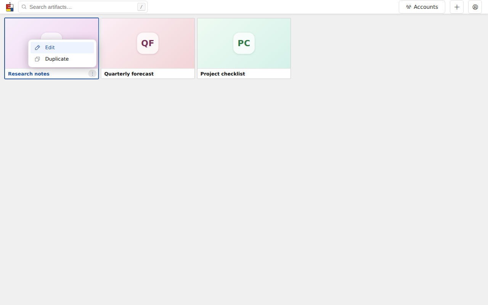
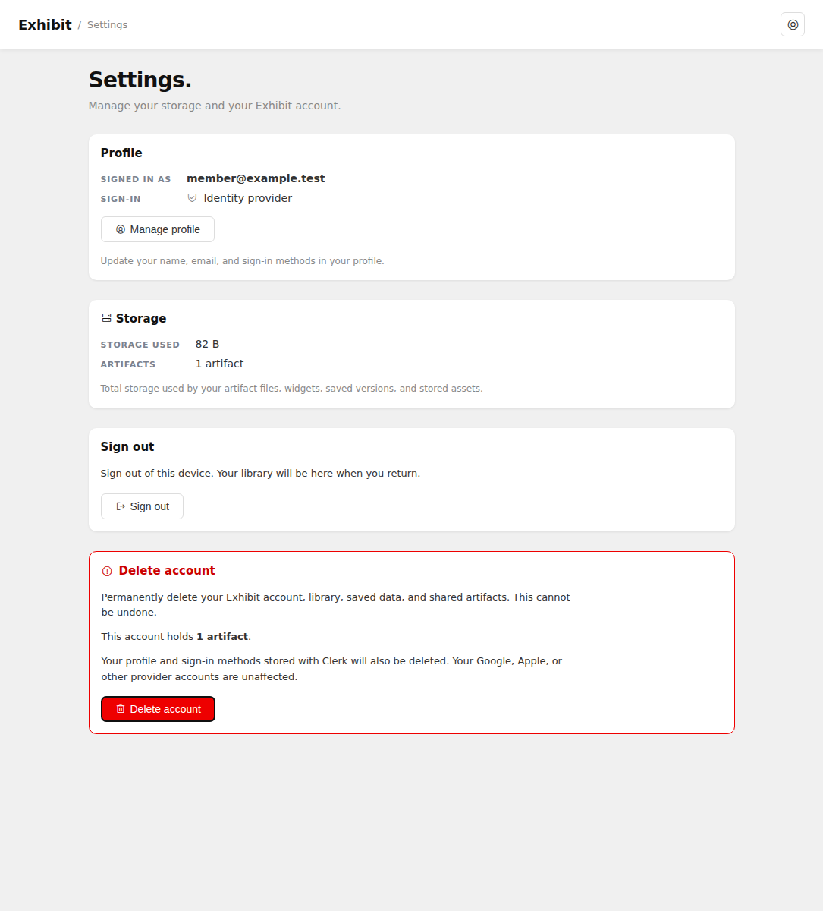

# Reusable UI components

A reusable gallery component consists of a Go template partial, shared CSS, and
a Stimulus controller. Go owns markup and data. Stimulus owns browser-only
interaction and lifecycle. htmx swaps server-rendered regions after mutations.

## Loading and registration

Include `{{template "componentScripts"}}` once in a full app page using shared
controllers. It loads `/assets/gallery/controllers.js` as a native ES module.
That entry point starts one application and explicitly registers controllers.
Relative imports resolve on the app origin. Fragments contain markup only;
inserting `data-controller` markup connects its controller automatically.

Stimulus is pinned in `web/stimulus/package.json`. `make assets` copies its ES
module and MIT license into the embedded assets. The gallery remains unbundled,
and production needs no Node process or external asset service.

## App header

Every full-document app page renders `{{template "appHeader" .Header}}` from
`templates/components.tmpl`: gallery and shared-library views, Settings,
artifact editor and viewer, account administration, agent, add-artifact,
not-found, and both local and hosted authentication pages.
`appHeaderView` in `internal/api/appheader.go` supplies page-owned content.
The default variant provides a title, optional logo/back link/search, and
native link or button actions. Route guards enforce permission independently.
The gallery and hosted Settings retain the shared `accountControl` menu,
including its recovery link. Authentication pages supply branding and their
page title without signed-in navigation or account controls; local sign-in
remains scriptless.

For a title and return to the gallery, populate the page's `Header` with
`subpageHeader("Page title")`. For a different destination, supply
`Back: &appHeaderBack{URL: destination, Label: destinationName}`. Set
`CollapseLabel` when the return label should become visually hidden on phones;
otherwise long labels truncate. `HideTitle` keeps a gallery heading available
to assistive technology without drawing it beside the logo.

Each `appHeaderAction` has a `Label` and self-hosted Phosphor `Icon`. `Href`
makes an anchor; otherwise it renders a button with an optional `ID`.
`LabelID` identifies a label that a feature updates, such as the agent key
status. An optional `TitleIcon` decorates the page title.
`IconOnly` hides the visible label at every width; other action labels become
visually hidden at 600px and below. Accessible names and tooltips remain.
`Primary` selects the primary button style. The editor's `SaveEditor` flag
retains its existing `data-save-editor` binding and unsaved-changes workflow.
Gallery search and filter markup stays in `galleryHeaderSearch`; its existing
Stimulus and htmx behavior remains attached to the stable gallery root.

`.app-header` and its child classes in `components.css` own the layout, including
when the bar is nested inside a gallery controller. The baseline is the
rendered gallery: 37px tall with 36px icon controls on desktop; 33px tall with
32px controls at 767px and below, plus any phone top safe-area inset. Horizontal
padding is 16px (8px at 360px and below), with 12px gaps. The gallery filter
layout tightens gaps on narrow screens. Page styles only extend feature layout,
not the bar's dimensions. `--header-height` supplies the shared minimum height;
the bar grows when account-service errors need more room. Hidden account recovery links remain
hidden until their controller reveals them.

The artifact viewer uses the `Floating` variant, populated by
`artifactHeader`. Its `floatingHeaderView` carries the title, created date,
posture, and which owner actions are available. `floatingAppHeader` owns the
pill, both popups, restore tab, and accessibility announcements; its styles
live in `components.css`. The `floating-header` Stimulus controller connects
`connectFloatingHeader` from `pip.js` and releases all listeners, observers,
timers, and animation frames on disconnect. Dragging, docking, hiding,
restoring, remembered placement, popup dismissal, and keyboard behavior are
preserved. The artifact still fills the viewport beneath these controls.

Standard headers need no new browser controller. Features compose their
existing controllers and native events. A template audit guards every full
app document against bypassing this component. Browser coverage includes the
standard pages at six widths, authentication pages without signed-in controls,
and floating-header interactions and disconnect/reconnect.

[Desktop gallery](screenshots/Exh-arf2/gallery-desktop.png) ·
[Phone gallery](screenshots/Exh-arf2/gallery-phone.png) ·
[Account](screenshots/Exh-arf2/account-desktop.png) ·
[Editor](screenshots/Exh-arf2/editor-desktop.png) ·
[Accounts](screenshots/Exh-arf2/admin-desktop.png) ·
[Add artifact](screenshots/Exh-arf2/new-desktop.png) ·
[Agent](screenshots/Exh-arf2/agent-desktop.png) ·
[Not found](screenshots/Exh-arf2/notfound-desktop.png) ·
[Viewer](screenshots/Exh-arf2/viewer-desktop.png) ·
[Sign in](screenshots/Exh-arf2/login-desktop.png)

## Defining action menus

A feature supplies an `actionMenuView`. Two different menus can be defined as:

```go
artifactActions := actionMenuView{
    ID: "artifact-actions-" + artifact.ID,
    Label: "Actions for " + artifact.Title,
    Items: []actionMenuItem{
        menuLink("Edit", "ph-pencil-simple", "/artifacts/"+artifact.ID+"/edit"),
        menuEvent("Duplicate", "ph-copy", "exhibit:duplicate",
            map[string]string{"artifactID": artifact.ID, "title": artifact.Title}),
    },
}

collectionActions := actionMenuView{
    ID: "collection-actions-" + collection.ID,
    Label: "Actions for " + collection.Name,
    Items: []actionMenuItem{
        menuLink("View collection", "ph-folder", "/collections/"+collection.ID),
        menuEvent("Rename", "ph-pencil-simple", "exhibit:rename-collection",
            map[string]string{"collectionID": collection.ID}),
    },
}
```

The collection routes and event illustrate a future consumer. Each feature
implements the routes and events it offers. Pass these values in the page view
model and render them using the same partial:

```html
{{template "actionMenu" .ArtifactActions}}
{{template "actionMenu" .CollectionActions}}
```

IDs must be unique in the document, including across paged fragments. `Label`
names the trigger and menu for assistive technology. `Icon` is an optional
self-hosted Phosphor class. Optional `Class`, `TriggerClass`, and `PanelClass`
adapt appearance and placement; the gallery retains its compact upward-opening
card menu. The default menu opens below its trigger.

`menuLink` renders an ordinary anchor. `menuEvent` renders a button dispatching
its named, bubbling event with the string payload in `event.detail`.
`detail.trigger` is the visible trigger for returning focus after a modal.
Payload JSON is escaped by `html/template` and decoded by Stimulus.

Feature code listens on its stable region:

```js
root.addEventListener('exhibit:rename-collection', event => {
  // Open the feature dialog using event.detail.collectionID.
  // Return focus to event.detail.trigger when it closes.
});
```

The controller handles toggling, dismissal, one open menu per document, arrow
keys, Home/End, typeahead, Tab exit, and Escape focus restoration. Features own
API calls and refresh events. Gallery duplication listens for
`exhibit:duplicate`; its form still uses `apiFetch` and requests its htmx refresh
with `exhibit:artifacts-changed`.



[Phone layout](screenshots/Exh-16ds/02-gallery-action-menu-mobile.png)

## Adding a controller, including the next modal

1. Add a native module under `web/gallery/` importing `Controller` from
   `../stimulus/stimulus.js`. Register it in `controllers.js` and add its file
   to `web/gallery/build.mjs`.
2. Define markup in a named Go partial. Use scoped targets for elements, values
   for configuration, and actions for events. Shared styles use design tokens.
3. Keep browser-only state on the controller. Keep its root stable when an
   htmx update must preserve that state. Replacing the root creates a new
   instance and does not automatically preserve an unsaved working copy.
4. Use `connect()` for per-connection setup and `disconnect()` to release timers,
   observers, and subscriptions. Stimulus manages `data-action` listeners.
5. Features perform authenticated API calls and emit the existing change events
   that htmx regions listen for. Controllers do not rebuild server markup.

The next modal component should wrap native `<dialog>` behavior, define initial
and return focus, and route Escape, backdrop, and explicit dismissal through
the same feature guard. Form contents and asynchronous saving belong to the
story implementing them. Existing dialogs retain their implementations until
migrated.

## Unsaved changes

The editor's body uses the registered `unsaved-changes` controller with the
`editorLeaveDialog` partial. Its `dialog` target supplies native focus
containment; its `status` target reports whether there are unsaved edits.
Escape and Keep editing close the dialog and return focus to the link.
Browser reload, Back, and tab closure use the native beforeunload prompt.
Protection resets on pageshow when browser Back restores a cached editor.
Confirmed deletion and version restoration emit `exhibit:editor-exit` before
navigating, so they do not ask for the same discard decision twice.

Sections register `isDirty`, asynchronous `save`, and `discard` operations with
`editor-session.js`. A successful save returns `true`; a failed or incomplete
save leaves its error on the page and returns `false`. The coordinator shares
in-flight saves, stops on failure, and checks for further edits before allowing
navigation. It preserves server-confirmed changes after partial saves.
The source and widget section tracks the submitted snapshot, so text entered
while a request is pending remains unsaved. Section code emits
`exhibit:editor-changed` when its internal working copy changes without a form
input event; CodeMirror emits input on its underlying textarea.

## Testing

The existing Node suite tests feature logic in its small DOM. Stimulus
integration uses a real browser through the existing `chromiumtest` helper:

```sh
make assets
go test ./internal/api -run 'Test(AppHeaderBrowser|ActionMenuBrowser|GalleryActionMenuDuplicationBrowser)$' -count=1
```

The helper finds a locally installed Playwright Chromium headless shell, or
uses `CHROMIUM_TEST_BINARY`. It skips browser tests when neither is available.
Cases cover two different menus, escaped payloads, keyboard/focus, actual htmx
replacements and appends, disconnect/reconnect, and the existing duplication
dialog. Add browser integration cases for new controllers; keep the miniature
Node DOM focused on feature logic.

## Account menu and Settings

The gallery and Settings header render the same `accountControl` template partial.
Hosted accounts have one Clerk user button. `clerk-menu.js` adds a Settings link
using Clerk's supported custom menu API. Clerk's Profile and Security screens
retain their standard content. Settings lives at `/settings` (`/profile` is a
compatibility alias) and offers storage usage, sign-out, and account deletion.
Its Manage profile button opens the unmodified Clerk profile modal. The Settings
header keeps that same account menu beside the Exhibit / Settings breadcrumb,
matching the approved interactive demo. Storage and artifact counts come from
the session owner, and the demo's sample data and simulated actions are confined
to `designs/settings-demo.html`.

The `account-deletion` controller is shared by hosted and self-hosted settings.
It reveals the server-rendered confirmation, resets the phrase on cancellation,
prevents duplicate requests, and displays the server's pending-deletion message
when provider cleanup needs retrying. The server enforces the confirmation and
last-administrator guard independently. `TestClerkAccountBrowser` covers the menu,
profile launch, Settings navigation, real artifact byte accounting and erasure,
confirmation, mobile layout, and complete or
pending deletion, with the provider UI boundary stubbed.

The screenshots show the real Settings page rendered with that provider stub:



[Phone layout](screenshots/Exh-r6a0/settings-mobile.png)
